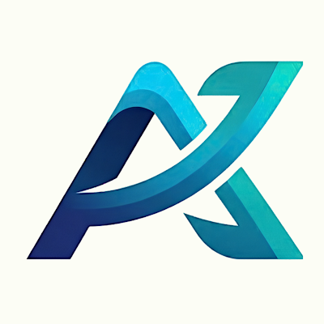
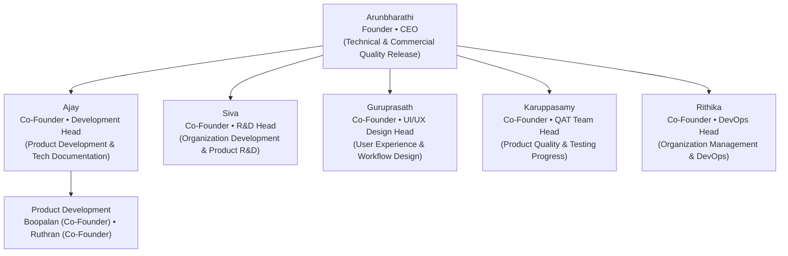

   

  

# AXINIX TECHNOLOGIES

### Corporate Portfolio & Foundational Strategy Blueprint

**Innovating Future, Today**

  

---

 

| Document Attribute | Specification |
| :--- | :--- |
| **Document Title** | Axinix Technologies — Corporate Portfolio & Foundational Strategy Blueprint |
| **Classification** | Confidential — Executive Council & Stakeholder Distribution |
| **Document Reference** | AXN-CORP-PORTFOLIO-2026 |
| **Effective Date** | November 2026 |
| **Corporate Status** | Executive Commercial Standard |

   

---

## Table of Contents

| Section | Topic | Page |
| :--- | :--- | :---: |
| **1.0** | [Company Identity and Vision](#10-company-identity-and-vision) | **03** |
| &nbsp;&nbsp;&nbsp;&nbsp;1.1 | [Why Axinix Technologies Exists](#11-why-axinix-technologies-exists) | 03 |
| &nbsp;&nbsp;&nbsp;&nbsp;1.2 | [The Problem We Are Solving](#12-the-problem-we-are-solving) | 03 |
| &nbsp;&nbsp;&nbsp;&nbsp;1.3 | [Strategic Positioning: The Organization We Are Becoming](#13-strategic-positioning-the-organization-we-are-becoming) | 04 |
| &nbsp;&nbsp;&nbsp;&nbsp;1.4 | [Horizon Milestones: 3-Year and 15-Year Ambition](#14-horizon-milestones-3-year-and-15-year-ambition) | 04 |
| **2.0** | [Organization and Responsibilities](#20-organization-and-responsibilities) | **05** |
| &nbsp;&nbsp;&nbsp;&nbsp;2.1 | [Leadership and Functional Responsibilities](#21-leadership-and-functional-responsibilities) | 05 |
| &nbsp;&nbsp;&nbsp;&nbsp;2.2 | [Distinction Between Partners and Employees](#22-distinction-between-partners-and-employees) | 06 |
| **3.0** | [Partnership, Ownership, and Governance](#30-partnership-ownership-and-governance) | **07** |
| &nbsp;&nbsp;&nbsp;&nbsp;3.1 | [Equity Allocation and Profit-Sharing Structure](#31-equity-allocation-and-profit-sharing-structure) | 07 |
| &nbsp;&nbsp;&nbsp;&nbsp;3.2 | [Governance Parity and Voting Rights](#32-governance-parity-and-voting-rights) | 07 |
| &nbsp;&nbsp;&nbsp;&nbsp;3.3 | [Reserved Critical Matters Requiring Unanimity](#33-reserved-critical-matters-requiring-unanimity) | 07 |
| &nbsp;&nbsp;&nbsp;&nbsp;3.4 | [Deadlock Escalation Protocol](#34-deadlock-escalation-protocol) | 08 |
| &nbsp;&nbsp;&nbsp;&nbsp;3.5 | [Corporate Structure and LLP Transition Pathway](#35-corporate-structure-and-llp-transition-pathway) | 08 |
| **4.0** | [Strategic Product Architecture](#40-strategic-product-architecture) | **09** |
| &nbsp;&nbsp;&nbsp;&nbsp;4.1 | [Core Product Portfolio](#41-core-product-portfolio) | 09 |
| &nbsp;&nbsp;&nbsp;&nbsp;4.2 | [Modular Interconnectivity Principle](#42-modular-interconnectivity-principle) | 10 |
| **5.0** | [Engineering Principles and Standardization Ladder](#50-engineering-principles-and-standardization-ladder) | **11** |
| &nbsp;&nbsp;&nbsp;&nbsp;5.1 | [Core Architectural Tenets](#51-core-architectural-tenets) | 11 |
| &nbsp;&nbsp;&nbsp;&nbsp;5.2 | [Three-Tier Standardization Ladder](#52-three-tier-standardization-ladder) | 11 |
| **6.0** | [Quality Assurance and Defect Cost Policy](#60-quality-assurance-and-defect-cost-policy) | **12** |
| &nbsp;&nbsp;&nbsp;&nbsp;6.1 | [Corporate Quality Mandate](#61-corporate-quality-mandate) | 12 |
| &nbsp;&nbsp;&nbsp;&nbsp;6.2 | [Classification of Defects vs. Chargeable Scope](#62-classification-of-defects-vs-chargeable-scope) | 12 |
| **7.0** | [Commercial Strategy and Business Model](#70-commercial-strategy-and-business-model) | **13** |
| &nbsp;&nbsp;&nbsp;&nbsp;7.1 | [Two-Pool Profit Distribution Model](#71-two-pool-profit-distribution-model) | 13 |
| &nbsp;&nbsp;&nbsp;&nbsp;7.2 | [Monthly Contribution Assessment](#72-monthly-contribution-assessment) | 13 |
| &nbsp;&nbsp;&nbsp;&nbsp;7.3 | [Capital, Emergency Reserve, and Exit Mechanics](#73-capital-emergency-reserve-and-exit-mechanics) | 14 |
| **8.0** | [Intellectual Property and Long-Term Assets](#80-intellectual-property-and-long-term-assets) | **15** |
| &nbsp;&nbsp;&nbsp;&nbsp;8.1 | [Hybrid Intellectual Property Governance](#81-hybrid-intellectual-property-governance) | 15 |
| &nbsp;&nbsp;&nbsp;&nbsp;8.2 | [Foundational Assets and Perpetual Licensing](#82-foundational-assets-and-perpetual-licensing) | 15 |

---

## 1.0 Company Identity and Vision

### 1.1 Why Axinix Technologies Exists

> **Mission Mandate**  
> Axinix Technologies exists as a technology solutions enterprise dedicated to analyzing real-world operational challenges from the ground up and engineering purpose-built solutions across industry sectors.

* **Confronting Core Bottlenecks:** Our technical capability is directed squarely at resolving critical industrial bottlenecks, unaddressed operational gaps, and persistent workflow friction that standard, commercial-off-the-shelf software consistently overlooks.
* **Authentic Engineering Solutions:** We do not deliver superficial patches or temporary workarounds. Every deployment is engineered to address the root cause, providing permanent, dependable operational clarity.

---

### 1.2 The Problem We Are Solving

> **The Cost of Application Sprawl**  
> Modern enterprises are overburdened by fragmented toolchains—forced to juggle disparate subscriptions, constantly switch browser tabs, and manage fragile bridges across isolated software products to execute basic daily workflows.

| Operational Dimension | Traditional Fragmented Toolchain | Axinix Unified Portal Architecture |
| :--- | :--- | :--- |
| **User Experience** | Multiple isolated applications requiring constant browser tab-switching and separate logins. | Single secure portal unifying all business modules within one cohesive interface. |
| **Data Integrity** | Siloed databases requiring manual CSV exports, error-prone sync scripts, and reconciliation. | Shared centralized data pipeline ensuring real-time operational consistency across departments. |
| **Deployment Footprint** | High vendor sprawl, redundant subscription billing, and fragmented support channels. | Streamlined modular deployment where capabilities activate seamlessly as the enterprise grows. |

* **Consolidated Operational Experience:** Axinix eliminates multi-vendor tool fragmentation by delivering complete, cohesive capabilities operating inside a unified portal.
* **Elimination of Multi-App Overhead:** Users access an integrated platform where cross-functional operations—from resource planning to client management—occur seamlessly in a single workspace.

---

### 1.3 Strategic Positioning: The Organization We Are Becoming

> **Excellence in Enterprise Solutions**  
> Axinix Technologies is built to establish a reputation as a trusted technology solutions enterprise—valued not merely as a contract software builder, but as an indispensable partner recognized for problem-solving excellence.

* **Reputation for Solution Delivery:** Clients who partner with Axinix rely on our precision in diagnosing and resolving complex operating environments, trusting the efficacy and durability of the outcome.
* **Ubiquitous Technology Impact:** Our long-range ambition is for Axinix Technologies to design, engineer, and power fundamental layers of the technology stack utilized across global enterprises.

---

### 1.4 Horizon Milestones: 3-Year and 15-Year Ambition

| Horizon | Strategic Scope | Key Commercial & Operational Deliverables |
| :--- | :--- | :--- |
| **3-Year Milestone** | Custom ERP & CRM Domain Precision | • Industry-wide recognition for high-precision Custom ERP and CRM deployments tailored to individual vertical workflows. • Flawless execution across manufacturing, retail, and service industry deployments. • Establishment of a trusted corporate client base with predictable, recurring operational value. |
| **15-Year Milestone** | Unified Technology Institution | • Evolution from a software solutions provider into an integrated technology enterprise with divisions across enterprise platforms, infrastructure, and hardware systems. • Recognition as the pioneering enterprise that unified corporate workflows into a single interface. • Powering the full spectrum of modern digital work within a single, secure environment. |

---

## 2.0 Organization and Responsibilities

### 2.1 Leadership and Functional Responsibilities

> **Organizational Accountability**  
> Axinix Technologies is directed by its Founder and Co-Founders, with each leader holding clear accountability over technical execution, product quality, design, research, operations, and commercial delivery.

| Leader | Status | Designation | Core Responsibilities |
| :--- | :--- | :--- | :--- |
| **Arunbharathi** | Founder | Chief Executive Officer (CEO) | Responsible for product technical and commercial quality release. |
| **Ajay** | Co-Founder | Development Head | Responsible for product development and documentation of technologies. |
| **Siva** | Co-Founder | R&D Head | Responsible for organization development and product research and development. |
| **Guruprasath** | Co-Founder | UI/UX Design Head | Responsible for product user experience and workflow designing. |
| **Karuppasamy** | Co-Founder | QAT Team Head | Responsible for product quality and testing progress. |
| **Rithika** | Co-Founder | DevOps Head | Responsible for organization management and DevOps progress. |
| **Boopalan** | Co-Founder | Product Development | Responsible for product development. |
| **Ruthran** | Co-Founder | Product Development | Responsible for product development. |

---

### 2.2 Distinction Between Partners and Employees

> **Stewardship vs. Employment**  
> Axinix Technologies draws a clear structural and cultural distinction between Founding Partners—who build the institution from inception—and Employees—who are appointed to support ongoing operations.

| Dimension | Partners | Employees |
| :--- | :--- | :--- |
| **Foundation & Timing** | Engaged prior to Axinix Technologies establishing formal organizational status, dedicating personal time and effort to build the company from the ground up. | Appointed by the leadership team after operational structures are established to support ongoing organizational needs. |
| **Core Motivation** | Committed to elevating Axinix Technologies as an institution and advancing all fellow partners collectively. | Driven primarily by personal wealth generation, individual compensation, and personal acknowledgement for their contributions. |
| **Knowledge & Mentorship** | Actively mentor junior team members and share institutional knowledge openly to strengthen the broader team. | Focus on fulfilling assigned tasks and individual career objectives rather than stewarding the organization or its partners. |
| **Execution Mindset** | Operate from ownership rather than mere obligation—possessing the capability to execute work directly as well as delegate, coordinate, and follow up with others to ensure delivery. | Execute designated responsibilities within defined job scopes as directed by functional leadership. |

* **Partner Expectations:** A Partner never treats responsibility as a reluctant obligation. Partners take initiative to advance both the company and their peers, combining hands-on execution capability with proactive leadership and follow-through across the team.
* **Employee Relationship:** Employees are valued contributors engaged for specific operational execution, operating for their own professional growth and financial reward without assuming institutional stewardship over the enterprise or its partners.

---

## 3.0 Partnership, Ownership, and Governance

### 3.1 Equity Allocation and Profit-Sharing Structure

> **Equal Ownership, Merit-Aligned Profit**  
> Axinix Technologies strictly separates institutional equity ownership from operational profit sharing—preserving equal foundational equity among all active founding members while governing profit distributions through a balanced two-pool system.

* **Equal Founding Equity (12.5% Each):** Every founding member holds an identical **12.5% equity stake** in the organization. This equity remains constant unless a partner formally discontinues their association with Axinix Technologies. Upon a partner's departure, the remaining equity continues to be redistributed equally among the continuing founding members (e.g., $100\% / N$ remaining partners).
* **Decoupled Profit-Sharing Allocations:** Profit-sharing percentages are assigned independently of equity ownership and do not carry the permanent guarantee of equity. A partner may relinquish—or have adjusted—their profit-sharing allocation while retaining their full equal equity stake intact.
* **Two-Pool Profit Governance:** Distributable corporate profits are divided equally into two distinct pools:

| Profit Pool | Share of Total Profit | Governance & Allocation Rules |
| :--- | :---: | :--- |
| **Static Base Profit Pool** | **50%** | Allocated on a rotational **2–3 year cycle** based on cumulative contribution, availability, and organizational usability.  **Current Base Allocations:** • **Arunbharathi:** 15% of total profit • **Ajay & All Other Co-Founders (7 Partners):** 5% each ($7 \times 5\% = 35\%$) |
| **Monthly Performance Pool** | **50%** | Evaluated **monthly** based on individual verified contribution points, with the 50% pool distributed proportionally to earned scores. |

* **Protection & 5-of-7 Committee Override Rule:** Each partner's Static Base allocation is reserved across the 2–3 year cycle. Even if a partner is unable to actively contribute for up to one year, their base profit-sharing allocation remains protected unless a committee of **5 out of the 7 remaining founding partners** formally determines that the individual's base allocation requires revision.

---

### 3.2 Governance Parity and Voting Rights

> **Equal Founder-Level Authority**  
> Management voting authority is strictly decoupled from economic ownership percentages. Every founding partner exercises exactly **one equal vote** on all reserved critical matters.

Changes to capital contribution ratios or profit-sharing allocations do not confer superior voting weight or override rights to any individual partner.

---

### 3.3 Reserved Critical Matters Requiring Unanimity

Under no circumstance may a majority vote (such as 7-to-1) pass any of the following nine strategic actions. Affirmative written approval from **all eight partners** is mandatory:

1. Modifying ownership percentages or capital contribution allocations.
2. Amending the structural 50/50 two-pool profit-sharing model itself (excluding scheduled 2–3 year rotational reviews or individual base adjustments enacted by a 5-of-7 partner committee under Section 3.1).
3. Admitting a new founding partner or removing an existing partner.
4. Incurring institutional debt, securing bank credit lines, or accepting major financial obligations.
5. Selling, transferring, assigning, or encumbering company assets or core intellectual property.
6. Entering major strategic partnerships, mergers, or joint ventures.
7. Changing the fundamental business direction or corporate purpose of Axinix Technologies.
8. Voluntarily dissolving, liquidating, or closing the enterprise.
9. Amending the Founders' Agreement, Corporate Charter, or governing covenants.

---

### 3.4 Deadlock Escalation Protocol

When consensus cannot be reached on a reserved critical matter, Axinix enforces a structured four-stage resolution pathway to preserve operational stability:

| Stage | Mechanism | Duration / Execution Standard | Outcome if Unresolved |
| :--- | :--- | :--- | :--- |
| **Stage 1** | Formal Internal Deliberation | 7 to 14 days of structured council review and evidence examination. | Escalates to Stage 2. |
| **Stage 2** | Independent Professional Mediation | Engagement of a neutral corporate mediator or legal advisor to facilitate compromise. | Escalates to Stage 3. |
| **Stage 3** | Mandatory Cooling-Off Period | 14 to 30 days of reflection followed by a final reconsideration vote. | Escalates to Stage 4. |
| **Stage 4** | Termination of Proposal | **The proposed motion fails automatically.** The existing lawful status quo remains intact. | Status quo preserved. |

---

### 3.5 Corporate Structure and LLP Transition Pathway

| Operational Phase | Legal Vehicle | Governance & Fiduciary Controls | Transition Trigger |
| :--- | :--- | :--- | :--- |
| **Phase 1: Interim Launch** | Sole Proprietorship registered in the name of **Ajay**, trading as *Axinix Technologies*. | Bound by a formal Multi-Party Internal Agreement incorporating a **Fiduciary Declaration of Trust** (confirming assets are held in trust for all 8 partners) and **Mutual Indemnity** shielding the proprietor from enterprise liabilities. | Immediate commercial launch. |
| **Phase 2: Permanent Vehicle** | **Axinix Technologies LLP**, incorporated under the *Limited Liability Partnership Act, 2008*. | All 8 founders admitted as partners under a Section 23 LLP Agreement embedding equal governance parity, 50/50 profit splits, and a formal Business Transfer Agreement (BTA) novating all client contracts and IP licenses. | **24 months of operations OR 7 active commercial clients** (whichever occurs first). |

---

## 4.0 Strategic Product Architecture

### 4.1 Core Product Portfolio

Axinix Technologies develops proprietary enterprise platforms designed to resolve sector-specific inefficiencies while establishing reusable internal infrastructure.

| Platform / Initiative | Classification | Strategic Role & Core Capabilities | Commercial Deployment Model |
| :--- | :--- | :--- | :--- |
| **AR.I.S** *(Artificial Intelligent System)* | Cognitive AI Substrate | Neural tensor and cognitive linguistic architecture supporting autonomous task reasoning, AST codebase inspections, and intelligent decision engines across Axinix products. | Proprietary internal intelligence layer powering enterprise solutions. |
| **Workhub** | Modular Enterprise Suite | Comprehensive business management platform spanning HRMS, biometric attendance, statutory payroll, SLA help desk, project Kanban, CRM, and IT asset ledgers. | Modular B2B SaaS; modules deployable independently or as a unified suite. |
| **Textile Industrial ERP & E-Commerce** | Vertical Enterprise Solution | Specialized manufacturing and retail ERP covering spinning, weaving, wet processing, loom tracking, multi-warehouse ledgers, and live marketplace synchronization. | Custom vertical deployment transitioning to industry-standard SaaS. |
| **Cafe & Retail Billing POS** | Commercial Operations | High-velocity point-of-sale billing, automated tax compliance, and real-time inventory deduction for retail and hospitality sectors. | Low-friction subscription SaaS. |
| **Populate Engine** | Core Engineering Platform | Metadata-driven declarative API pipeline featuring AST query parsing, field-level RBAC enforcement, automated data sanitization, and immutable request auditing. | Proprietary internal framework accelerating all product development. |

---

### 4.2 Modular Interconnectivity Principle

> **Ecosystem Autonomy**  
> Every Axinix product is engineered to provide standalone commercial value while delivering compounded capability when integrated within the wider ecosystem.

* **No Forced Bundling:** Clients may adopt an individual module—such as payroll, inventory, or billing—to solve an immediate bottleneck without being compelled to purchase an entire suite.
* **Shared Architectural Foundations:** Underlying services including identity management, role-based access control, unified notifications, storage interfaces, and billing remain standardized across products to ensure frictionless interoperability.

---

## 5.0 Engineering Principles and Standardization Ladder

### 5.1 Core Architectural Tenets

1. **Understand Before Architecting:** Technical designs must follow documented, client-confirmed operational problem statements.
2. **Structural Integrity Over Patches:** Solutions address systemic architectural causes rather than introducing brittle, short-term code bypasses.
3. **Clear Module Boundaries:** Domain business logic resides within decoupled service pipelines, maintaining strict separation from transport layers.
4. **Security & Performance by Default:** Minimal database lock windows, composite indexing, automated payload sanitization, and comprehensive audit logging are mandatory across all deployments.
5. **Institutional Knowledge Preservation:** All architectural decisions, data models, and operational lessons are systematically documented to prevent single-point-of-failure tribal knowledge.

---

### 5.2 Three-Tier Standardization Ladder

Axinix governs feature evolution using a disciplined three-tier classification model to prevent single-client edge cases from polluting core software platforms.

| Tier | Trigger Condition | Engineering Execution |
| :--- | :--- | :--- |
| **Tier 1: Client-Specific Customization** | Requirement is unique to a single client's proprietary internal policy or approval workflow. | Implemented via isolated configuration hooks, plugins, or client-specific extensions following commercial review; never alters core platform behavior. |
| **Tier 2: Generalized Reusable Capability** | Multiple clients express variations of a shared underlying operational need (e.g., flexible dashboard analytics or multi-level approvals). | Engineered as an abstract, configurable core module allowing each client to customize parameters without code duplication. |
| **Tier 3: Industry-Wide Standard** | Requirement is universally applicable across an industry or mandated by statutory regulation (e.g., tax legislation or e-invoicing). | Incorporated natively into the standard industry product with support for applicability rules, exemptions, and effective dates. |

---

## 6.0 Quality Assurance and Defect Cost Policy

### 6.1 Corporate Quality Mandate

> **The Axinix Quality Covenant**  
> *"Our mistakes are our responsibility. Our clients should pay for value delivered, not for our failures. Our employees should be fairly compensated for the work they perform."*

Axinix acknowledges that complex enterprise software carries inherent engineering risks. Our organizational discipline centers on transparent accountability, root-cause elimination, and ethical treatment of both clients and engineering personnel.

* **Client Protection:** Genuine defects attributable to Axinix engineering or implementation are remediated at zero additional charge to the client—regardless of whether initial warranty periods have expired.
* **Employee Protection:** Developers, QA engineers, and implementation personnel receive full standard compensation for investigating and resolving defects. Quality assurance and bug remediation represent an operational delivery cost borne by the company, never unpaid labor demanded from staff.
* **Systemic Evaluation:** Individual engineers are never evaluated via simplistic bug-count metrics; defects are audited within the context of specification clarity, system complexity, and test coverage.

---

### 6.2 Classification of Defects vs. Chargeable Scope

Every reported issue undergoes a formal classification audit prior to remediation:

| Classification | Definition & Root Cause | Commercial & Billing Treatment |
| :--- | :--- | :--- |
| **Internal Engineering Defect** | Software failure, logic flaw, or unhandled regression originating within Axinix-authored code relative to agreed specifications. | Remediated by Axinix at **zero cost to the client**. |
| **Chargeable Change Request** | New functional requirements, workflow alterations, or modifications to previously signed-off acceptance criteria. | Scoped, estimated, and billed under standard commercial rates following client approval. |
| **External / Third-Party Failure** | Outages, breaking API changes, or infrastructure faults originating from third-party vendors, upstream providers, or unauthorized client environment changes. | Investigated transparently; remediation billed or coordinated per applicable service terms. |

---

## 7.0 Commercial Strategy and Business Model

### 7.1 Two-Pool Profit Distribution Model

All partner distributions are calculated exclusively from verified **Distributable Net Profit**—never from gross revenue or cash receipts—following the deduction of salaries, direct project costs, operational overheads, statutory taxes, approved reserves, and prior-period losses.

| Profit Pool | Share of Distributable Profit | Allocation Mechanism |
| :--- | :---: | :--- |
| **Static Base Pool** | **50%** | Rotational **2–3 year cycle** based on contribution, availability, and usability. **Current:** Arunbharathi (15%) • Ajay & 6 Co-Founders (5% each = 35%). |
| **Monthly Performance Pool** | **50%** | Distributed monthly in direct proportion to each partner's verified **Contribution Points** (where collective scores total 100%). |

* **Formula:** $\text{Total Distribution}_i = \left( \text{Static Base Share}_i \times P_{\text{dist}} \right) + \left( \frac{\text{Contribution Score}_i}{100} \times 0.50 \times P_{\text{dist}} \right)$
* **Inactivity Protection & 5-of-7 Committee Rule:** A partner's Static Base allocation is reserved across the 2–3 year cycle—remaining protected even if a partner is inactive for up to one year—unless a committee of **5 out of the 7 remaining founding partners** determines that the individual's base allocation requires modification.

---

### 7.2 Monthly Contribution Assessment

Monthly performance scores are determined strictly by **verified results and deliverables**, never by hours logged or online attendance.

* **Evaluation Criteria:** Shipped engineering deliverables (25%), quality and architectural rigor (20%), ground discovery and client impact (20%), revenue and commercial milestones (15%), R&D and reusable asset creation (10%), and team mentorship and knowledge capital (10%).
* **Collective Audit & Dispute Resolution:** The eight partners collectively review monthly evidence portfolios. Unresolved scoring disputes are referred to an independent external reviewer (such as a neutral Chartered Accountant or industry advisor) for binding assessment.

---

### 7.3 Capital, Emergency Reserve, and Exit Mechanics

* **Company-Funded Growth:** Ordinary product development and expansion are funded exclusively through operational revenues and retained earnings. Founders bear no automatic obligation to inject personal capital for speculative initiatives.
* **External Investment:** External funding is permitted only upon 100% unanimous founder approval and must exclude investor control over daily engineering or departmental operations.
* **Ring-Fenced Emergency Reserve:** Axinix maintains a liquid emergency reserve targeted at **10% of agreed enterprise valuation**, funded primarily from retained company profits. This reserve is dedicated strictly to existential emergencies and **cannot be utilized to finance founder exit buyouts**.
* **Partner Exit & Valuation Buyout:** Departing partners must offer their interest internally rather than transferring equity to third parties. Settlements are anchored by an independent professional valuation, ratified unanimously by remaining partners, and disbursed in structured tranches (25% upon closing, 75% across 12–24 months) to preserve operating liquidity.
* **Orderly Cessation:** Axinix rejects unlimited personal debt exposure. Should the enterprise become commercially unsustainable, operations cease in an orderly manner to extinguish employee wages, taxes, and verified creditor claims without imposing continuing personal debt on founders.

---

## 8.0 Intellectual Property and Long-Term Assets

### 8.1 Hybrid Intellectual Property Governance

| Asset Category | Ownership Title | Commercial & Operational Rights |
| :--- | :--- | :--- |
| **Pre-Existing Personal IP** | Retained by Original Creator | Licensed perpetually and exclusively to Axinix Technologies for commercial deployment within approved business lines. |
| **Post-Founding Enterprise IP** | Owned by Axinix Technologies | All code, architectures, products, documentation, and trademarks funded by or created specifically for Axinix belong solely to the enterprise. |
| **Client-Specific Deliverables** | Governed by Client MSA | Clients own bespoke configurations and proprietary business data; Axinix retains full title to underlying engines and platform frameworks. |
| **Third-Party & Open Source** | Original Licensors | Utilized strictly in compliance with applicable open-source and commercial licensing terms. |

---

### 8.2 Foundational Assets and Perpetual Licensing

Prior to the multi-founder structure, Arunbharathi independently architected four foundational technology assets:
1. **Textile Industrial ERP Core Engine**
2. **Populate Engine (Metadata AST Architecture)**
3. **Workhub Platform Core Micro-Services**
4. **AR.I.S (Artificial Intelligent System) Neural Substrate**

* **Perpetual Enterprise License:** Arunbharathi retains original legal authorship while granting Axinix Technologies a perpetual, irrevocable, worldwide commercial license to deploy, modify, maintain, and sub-license these foundations to enterprise clients.
* **Standard Profit Participation:** Commercial revenues generated from these assets flow seamlessly into the standard 50/50 profit-sharing pools. **No separate IP royalty (such as 10%) or additional time surcharge (such as 5%) is levied.**
* **Continuity Escrow:** Source repositories, commit histories, and deployment keys are archived in encrypted multi-party offline escrow to guarantee uninterrupted operational continuity under all contingencies.

---

  

**Axinix Technologies** — *Innovating Future, Today*  
Confidential & Proprietary © 2026 Axinix Technologies. All rights reserved.

