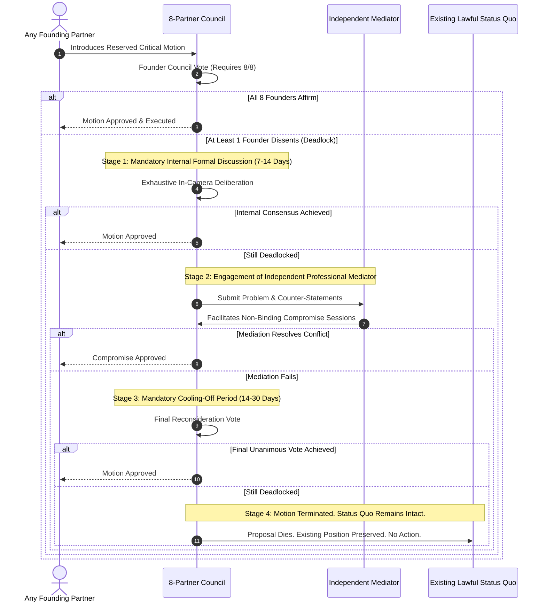
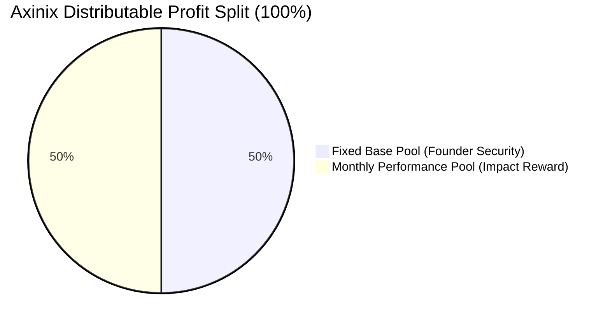
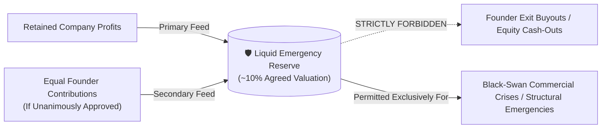
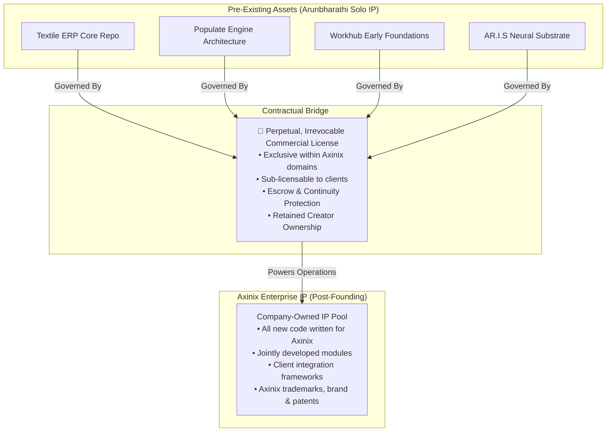
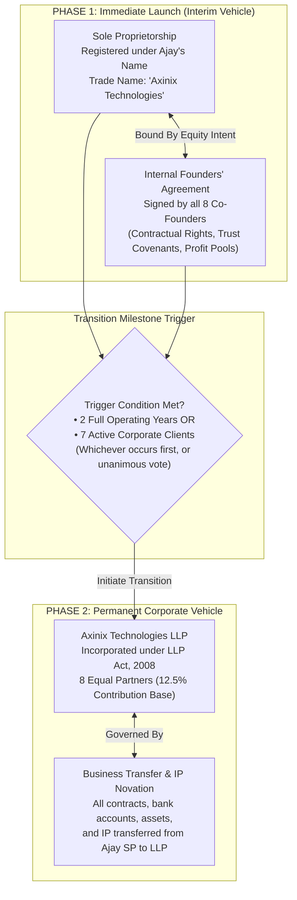
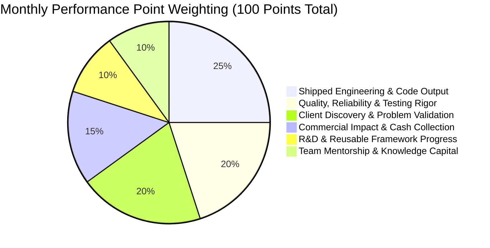
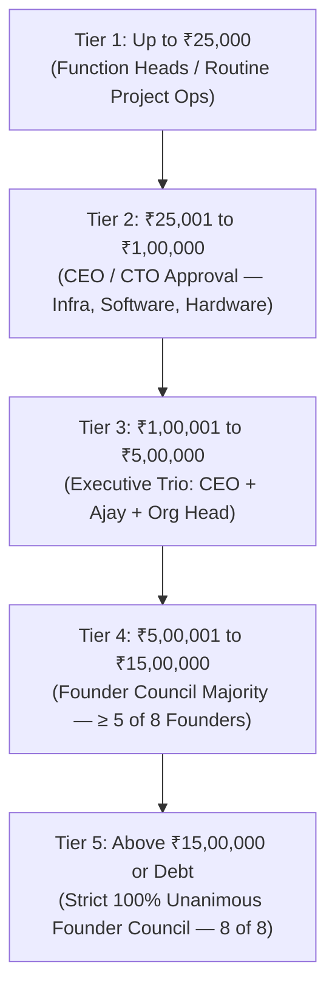

<div align="center">

<p align="center">
  
</p>

# 🌌 AXINIX TECHNOLOGIES
### CORPORATE CHARTER & COMMERCIAL PLAYBOOK
**Enterprise Operating Model, Executive Governance & Strategic System Architecture**

```
╔═══════════════════════════════════════════════════════════════════════════════════════════╗
║                             "INNOVATING FUTURE, TODAY"                                    ║
╚═══════════════════════════════════════════════════════════════════════════════════════════╝
```

[](#)
[](#)
[](#)
[](#)

---

</div>

> [!IMPORTANT]
> **Executive Operational Blueprint**  
> This Corporate Charter serves as the definitive **Commercial & Architectural Operating Playbook** for Axinix Technologies. It governs the internal partnership covenants, product architectures, financial profit engines, and strategic operational roadmaps for the enterprise.

---

# 📑 TABLE OF CONTENTS
1. [Corporate Purpose, Vision & Strategic Ambition](#1-corporate-purpose-vision--strategic-ambition)
2. [Executive Leadership Council & Organizational Roles](#2-executive-leadership-council--organizational-roles)
3. [Two-Tier Governance, Decision-Making & Deadlock Protocol](#3-two-tier-governance-decision-making--deadlock-protocol)
4. [Commercial Financial Model: Two-Tier Profit-Sharing Engine](#4-commercial-financial-model-two-tier-profit-sharing-engine)
5. [Capital, Emergency Reserve & Risk Management](#5-capital-emergency-reserve--risk-management)
6. [Commercial Product Portfolio & Standardization Ladder](#6-commercial-product-portfolio--standardization-ladder)
7. [Quality Policy, Defect Ownership & Engineering Fairness](#7-quality-policy-defect-ownership--engineering-fairness)
8. [Intellectual Property Architecture & Founder Licensing](#8-intellectual-property-architecture--founder-licensing)
9. [Corporate Structure & LLP Transition Pathway](#9-corporate-structure--llp-transition-pathway)
10. [Partner Exit, Valuation & Transfer Mechanics](#10-partner-exit-valuation--transfer-mechanics)
11. [Ratified Governance Policies & Pre-Execution Checklist](#11-ratified-governance-policies--pre-execution-checklist)
12. [Contractual Schedules & Execution Blueprints](#12-contractual-schedules--execution-blueprints)

---

# 1. CORPORATE PURPOSE, VISION & STRATEGIC AMBITION

### 1.1 The Corporate Tagline & Commercial Mission

$$\bbox[10px,border:2px solid #0284c7,background-color:#f0f9ff]{\Large\textbf{Axinix Technologies — Innovating Future, Today}}$$

* **Innovating Future:** We engineer autonomous AI intelligence (AR.I.S), high-throughput enterprise platforms, and modular cloud architectures designed to solve complex real-world operational challenges.
* **Delivering Today:** We focus on immediate commercial execution, dependable software quality, and rapid enterprise value creation without unnecessary friction.
* **Engineering Independence:** Over time, Axinix develops and owns its core technology stack, software engines, and operational platforms, delivering maximum reliability and freedom to our enterprise clients.

### 1.2 Purpose, Vision & Mission

```text
┌────────────────────────────────────────────────────────────────────────────────────────┐
│ PURPOSE: Build a dependable technology enterprise solving deep, real-world problems.   │
└────────────────────────────────────┬───────────────────────────────────────────────────┘
                                     │
           ┌─────────────────────────┴─────────────────────────┐
           ▼                                                   ▼
┌──────────────────────────────────────┐    ┌──────────────────────────────────────┐
│ VISION: Globally recognized tech     │    │ MISSION: Ground-level discovery,     │
│ leader known for dependable software,│    │ thoughtful engineering, configurable │
│ AI platforms & cloud infrastructure. │    │ architectures & continuous value.    │
└──────────────────────────────────────┘    └──────────────────────────────────────┘
```

### 1.3 Reputation Pillars: What Axinix Stands For
1. **Understand Before Engineering:** Never prescribe architecture before immersing in the physical environment where operational friction occurs.
2. **Solving the Overlooked & Complex:** Focus on unglamorous, foundational, and persistent industry pain points that off-the-shelf software fails to address.
3. **Operational Dependability:** Systems must function seamlessly under harsh, real-world industrial and commercial conditions.
4. **Reusable & Configurable Architecture:** Generalize recurring business patterns instead of repeatedly developing brittle one-off codebases.
5. **Radical Fairness:** Absolute transparency and ethical alignment with customers, founding partners, and employees.
6. **Defect Accountability:** Stand behind engineering output without shifting internal failure costs onto clients or engineering staff.
7. **Long-Term Capability Building:** Continual reinvestment in patents, internal proprietary engines, and institutional knowledge.
8. **Ecosystem Autonomy:** Modular product design where components are independently viable and exponentially more powerful when interconnected.

### 1.4 The 15-Year Strategic Horizon

```mermaid
timeline
    title Axinix 15-Year Strategic Commercial Evolution
    section Phase 1: Years 1-3
        Enterprise Foundation : Custom Industry Solutions : Textile ERP & Billing : Profitability & Cash Reserves : Workhub Platform Genesis
    section Phase 2: Years 4-5
        Modular SaaS Growth : Workhub Modular Platform : Office Productivity Suite : Centralized Identity & Storage
    section Phase 3: Years 6-10
        Extended Infrastructure : Business Communication & Mail : Server Management Platforms : Virtualization & Cloud Research
    section Phase 4: Years 11-15
        Hardware & Data Centres : Proprietary Server Designs : Data Centre Facilities : Connected Devices & Ecosystem OS
```

---

# 2. EXECUTIVE LEADERSHIP COUNCIL & ORGANIZATIONAL ROLES

Axinix is directed by an eight-member executive council combining enterprise software engineering, quality assurance, infrastructure operations, and business strategy.

```
                               ┌────────────────────────────────┐
                               │         ARUNBHARATHI           │
                               │      Founder, CEO & CTO        │
                               │  (Strategic & Tech Leadership) │
                               └───────────────┬────────────────┘
                                               │
             ┌─────────────────────────────────┼─────────────────────────────────┐
             │                                 │                                 │
             ▼                                 ▼                                 ▼
┌─────────────────────────┐       ┌─────────────────────────┐       ┌─────────────────────────┐
│          AJAY           │       │         RITHIKA         │       │          SIVA           │
│ Development & Processing│       │ Org Operations & DevOps │       │ Business Strategy & R&D │
│ (Interim Legal Entity)  │       │ (Ops, Deploy, Culture)  │       │ (Market Growth, Labs)   │
└────────────┬────────────┘       └─────────────────────────┘       └─────────────────────────┘
             │
             ├─────────────────────────────────────────────────┐
             │                                                 │
             ▼                                                 ▼
┌─────────────────────────┐                       ┌─────────────────────────┐
│   CORE DEVELOPMENT      │                       │    QUALITY ASSURANCE    │
│  • Boopalan (Core Lead) │                       │  • Guru Prasanth (QA)   │
│  • Ruthran (Frontend)   │                       │  • Karuppasamy (QA/Test)│
└─────────────────────────┘                       └─────────────────────────┘
```

### 2.1 Executive Roster & Functional Responsibilities

| Partner Name | Core Designation / Functional Role | Primary Operational Scopes | Authority & Signing Limits |
|:---|:---|:---|:---|
| **Arunbharathi** | **Chief Executive Officer & CTO** | Executive vision, technology roadmap, system architecture, operational deadlock tie-breaking. | Strategic representation, company-wide operational direction, core IP custody. |
| **Ajay** | **Head of Development & Processing** | Engineering pipeline management, process execution, interim proprietorship fiduciary holder. | Interim commercial signatory, developmental resource allocation. |
| **Boopalan** | **Core Development Lead** | Backend business services, database design, Populate Engine implementation, core API workflows. | Module-level architecture and code-review authorization. |
| **Guru Prasanth** | **Quality Assurance Lead** | Test planning, manual & exploratory validation, regression test coverage, release certification. | Release sign-off authority for production deployment readiness. |
| **Karuppasamy** | **QA & Test Automation Specialist** | Automated testing, integration verification, client simulation workflows, defect reproduction. | Test suite compliance and defect verification gates. |
| **Rithika** | **Head of Operations & DevOps** | Operational efficiency, team rhythm, CI/CD pipelines, cloud infra, internal culture, documentation. | Infrastructure budget limits, operational scheduling, workspace management. |
| **Ruthran** | **Senior Frontend Engineer** | Client module development, frontend reusability, Workhub UI, responsive enterprise interfaces. | Component implementation and interface validation. |
| **Siva** | **Head of Business Strategy & R&D** | Market discovery, client problem validation, competitive analysis, exploratory research & pilots. | Field discovery authorization, marketing campaigns, client validation reports. |

---

# 3. TWO-TIER GOVERNANCE, DECISION-MAKING & DEADLOCK PROTOCOL

Axinix decouples **Management Voting Authority** from **Economic Ownership Percentage**. Regardless of whether capital or profit-sharing percentages adjust in the future, every founding partner retains equal voice on foundational decisions.

### 3.1 Governance Tiers

```text
┌────────────────────────────────────────────────────────────────────────────────────────┐
│ TIER 1: RESERVED CRITICAL MATTERS (100% UNANIMOUS FOUNDER CONSENT REQUIRED)           │
│ • 1 Partner = 1 Vote • Equity % Does Not Grant Veto Override • No Supermajority Bypass │
└────────────────────────────────────────────────────────────────────────────────────────┘
                                            │
                                            ▼
┌────────────────────────────────────────────────────────────────────────────────────────┐
│ TIER 2: DAY-TO-DAY OPERATIONAL GOVERNANCE (ROLE-BASED AUTONOMY)                        │
│ • Function Leads make routine operational decisions within approved budgets            │
│ • Unresolved cross-functional deadlocks resolved by CEO/CTO (Executive Tie-Breaker)    │
└────────────────────────────────────────────────────────────────────────────────────────┘
```

### 3.2 The 9 Reserved Critical Matters (Strict Unanimity)

> [!CAUTION]
> Under no circumstance may a majority (e.g., 7-to-1) override any reserved matter. The following nine decisions require the affirmative written signature of **all eight founders**:

1. **Alteration of Capital or Economic Ownership:** Modifying partner contribution quotas or equity shares in the LLP.
2. **Amendment of the Profit-Sharing Framework:** Modifying the 50/50 Fixed vs. Performance pool structure or baseline percentages.
3. **Admission or Removal of a Partner:** Onboarding any new partner or terminating/expelling an existing founding partner.
4. **Incurring Major Financial Debt or Borrowing:** Taking bank loans, institutional credit, or encumbering company assets.
5. **Sale, Transfer, or Encumbrance of Company Assets or IP:** Assigning, licensing externally, or disposing of proprietary software, source code, or infrastructure.
6. **Execution of Major Strategic Partnerships:** Entering joint ventures, mergers, exclusive distribution agreements, or equity alliances.
7. **Fundamental Pivot of Business Scope:** Substantially altering Axinix's industry focus, core corporate purpose, or charter.
8. **Voluntary Dissolution, Winding Up, or Sale of Axinix:** Commencing liquidation, insolvency filings, or selling the firm.
9. **Amendment of the Corporate Charter or Covenants:** Modifying any clause within this governing constitution.

### 3.3 Critical Decision Deadlock Escalation Workflow



---

# 4. COMMERCIAL FINANCIAL MODEL: TWO-TIER PROFIT-SHARING ENGINE

Axinix's financial architecture decouples immediate livelihood security from monthly output, ensuring long-term dedication while rewarding high-impact monthly contributions.

### 4.1 The Two-Pool Profit Distribution Architecture

All distributions are derived strictly from **Distributable Net Profit**, never from gross client billings or cash receipts.



```
                                 TOTAL DISTRIBUTABLE NET PROFIT (100%)
                                                   │
                 ┌─────────────────────────────────┴─────────────────────────────────┐
                 ▼                                                                   ▼
       FIXED BASE POOL (50%)                                            PERFORMANCE POOL (50%)
  ┌───────────────────────────────┐                                 ┌───────────────────────────────┐
  │ • Arunbharathi : 15% of Net   │                                 │ • 100% Contribution Points    │
  │ • Ajay         :  5% of Net   │                                 │   allocated across 8 founders │
  │ • Boopalan     :  5% of Net   │                                 │   based on monthly outputs.   │
  │ • Guru Prasanth:  5% of Net   │                                 │                               │
  │ • Karuppasamy  :  5% of Net   │                                 │ • Share = (Score_i / 100)     │
  │ • Rithika      :  5% of Net   │                                 │           * 50% of Net Profit │
  │ • Ruthran      :  5% of Net   │                                 │                               │
  │ • Siva         :  5% of Net   │                                 │ • Rewards delivery, impact,   │
  │ Total          : 50% of Net   │                                 │   complexity, quality.        │
  └───────────────────────────────┘                                 └───────────────────────────────┘
```

> [!NOTE]
> **Mathematical Clarification:**  
> The 15% and 5% figures represent **direct percentages of total Distributable Net Profit**, summing exactly to 50%. They are not fractional subdivisions of the 50% pool itself.

### 4.2 Mathematical Formulation of Founder Distribution

For any given calendar month $m$, let $P_{\text{dist}}$ be the verified Distributable Net Profit. For founder $i$:

$$\text{Total Distribution}_i = \left( \text{Fixed Share}_i \times P_{\text{dist}} \right) + \left( \frac{\text{Contribution Score}_i}{100} \times 0.50 \times P_{\text{dist}} \right)$$

Where:
* $\sum_{i=1}^{8} \text{Fixed Share}_i = 0.50$ (Arunbharathi = 0.15, Co-Founders 1–7 = 0.05 each)
* $\sum_{i=1}^{8} \text{Contribution Score}_i = 100.0$

### 4.3 Inactivity Protection Principle
If a partner experiences temporary illness, personal emergencies, or low measurable deliverables during month $m$, their **Monthly Performance Score** may drop (even to 0%), but their **Fixed Base Allocation (5% or 15%) remains inviolate and protected**. It cannot be docked, penalized, or stripped without a 100% unanimous vote under Reserved Matter #2.

### 4.4 Audit Definition of Distributable Net Profit

Distributable Profit is computed only after the following mandatory deductions:

```text
  Gross Revenue Collected & Earned
- [ Direct Project Costs + Hosting + Infrastructure + Third-Party SaaS ]
- [ Approved Employee & Contractor Payroll ]
- [ Operational Overheads + Office + Administrative Costs ]
- [ Statutory Tax Obligations + GST + TDS + Professional Taxes ]
- [ Mandatory Allocation to Liquid Emergency Reserve (Target: 10% Valuation) ]
- [ Approved Capital Reserves for Confirmed R&D Pipeline ]
- [ Absorption of Prior-Period Cumulative Accounting Losses ]
═════════════════════════════════════════════════════════════════════════
= DISTRIBUTABLE NET PROFIT (Allocated 50% Fixed / 50% Performance)
```

---

# 5. CAPITAL, EMERGENCY RESERVE & RISK MANAGEMENT

```
┌────────────────────────────────────────────────────────────────────────────────────────┐
│                        AXINIX CAPITAL & RISK PHILOSOPHY                                │
│  "Growth is company-funded. No automatic personal debt calls. Liquid emergency buffer."│
└────────────────────────────────────────────────────────────────────────────────────────┘
```

### 5.1 Company-Funded Growth Principle
Product development, hiring, and expansion must be funded from operational cash surplus and retained earnings. **Founders bear no automatic obligation to contribute personal capital** for speculative initiatives. If available company reserves are inadequate, projects are deferred until internal funds permit.

### 5.2 External Funding & Strategic Capital
External capital is permitted only when an essential strategic opportunity cannot be realized organically.
* **Unanimous Approval Required:** Reserved Matters #4 & #6 apply.
* **Non-Negotiable Investor Guardrails:** External investors shall not receive operational, managerial, or engineering vetoes over day-to-day work. Investor protections are restricted to customary non-dilution, board observer, and standard financial reporting covenants.

### 5.3 Ring-Fenced Liquid Emergency Reserve



1. **Target Capitalization:** Maintained at approximately **10% of agreed enterprise valuation** (or a minimum rolling 6-month operational expense baseline).
2. **Funding Mechanism:** Sequenced first from retained monthly operational surplus; supplemented by equal cash contributions from all 8 founders only upon unanimous approval.
3. **Absolute Ring-Fencing:** The Emergency Reserve is dedicated to existential corporate survival. **It can never be tapped, liquidated, or pledged to finance a departing partner's buyout or settlement.**

### 5.4 Loss Allocation & Orderly Cessation
Axinix explicitly rejects open-ended personal partner liability. If market conditions deteriorate to the point where the business cannot sustain operations from revenues and reserves, the enterprise shall execute an **Orderly Closure Protocol**:
* Stop new client commitments immediately.
* Complete or equitably settle existing customer milestones.
* Liquidate non-core assets to extinguish employee wages, statutory taxes, and verified vendor liabilities.
* Dissolve the legal partnership cleanly without creating continuing personal indebtedness among partners.

---

# 6. COMMERCIAL PRODUCT PORTFOLIO & STANDARDIZATION LADDER

### 6.1 Current Portfolio Initiatives

| Initiative | Technical Nature | Strategic Role in Ecosystem | Commercial Model |
|:---|:---|:---|:---|
| **Textile Industrial ERP** | Vertical Manufacturing ERP | Ground-level industry immersion; foundational vertical proof-point. | Custom implementation $\rightarrow$ Vertical SaaS |
| **Workhub Platform** | Modular Business Suite | Interconnected, independently purchasable operational modules (HR, Inventory, Billing). | Modular Subscription |
| **Café / Shop Billing POS** | Point-of-Sale & Operations | Lightweight, high-velocity commercial billing engine. | Low-friction SaaS + Hardware Bundle |
| **Populate Engine** | Core Engineering Framework | High-speed, model-driven, metadata-based application generation pipeline. | Internal Proprietary Core |
| **AR.I.S** | Neural Tensor & AI Platform | Cognitive architecture and neural linguistic intelligence research. | Deep-Tech Internal Substrate |

### 6.2 The Three-Tier Standardization Ladder

```
                    ┌────────────────────────────────────────────────────────┐
                    │               THE STANDARDIZATION LADDER               │
                    └────────────────────────────────────────────────────────┘

    [ LEVEL 3: INDUSTRY STANDARD ]
    ▲ Validated across multiple sector leaders or mandated by statutory law.
    │ Baked into Core Base Platform with configurable compliance toggles.
    │ (Example: Statutory tax calculation rules, standard e-invoicing).
    │
    ├────────────────────────────────────────────────────────────────────────┐
    │ [ LEVEL 2: REUSABLE GENERALIZED CAPABILITY ]                           │
    │ Expressed by multiple clients with varying operational policies.       │
    │ Built as an abstract, configurable module with flexible parameters.    │
    │ (Example: Dynamic role-based approval matrices, custom dashboard widgets).
    │
    ├────────────────────────────────────────────────────────────────────────┐
    │ [ LEVEL 1: CLIENT-SPECIFIC CUSTOMIZATION ]                             │
    │ Unique to a single customer's operational preference or legacy policy. │
    │ Handled via custom hooks, plugins, or extensions; never pollutes core. │
    │ (Example: Single-firm mandatory supervisor sign-off on inward GRN).    │
```

---

# 7. QUALITY POLICY, DEFECT OWNERSHIP & ENGINEERING FAIRNESS

Axinix rejects shifting the financial burden of software bugs onto customers (via inflated maintenance fees) or onto developers (via unpaid overtime).

```
╔═══════════════════════════════════════════════════════════════════════════════════════════╗
║                                 THE AXINIX QUALITY TRINITY                                ║
║                                                                                           ║
║   "Our mistakes are our responsibility.                                                   ║
║    Our customers should pay for value delivered, not for our failures.                    ║
║    Our employees should be fairly compensated for the work they perform."                 ║
╚═══════════════════════════════════════════════════════════════════════════════════════════╝
```

### 7.1 Operational Rules of Defect Ownership
1. **No Defect-to-Feature Shifting:** If a deliverable fails to perform to verified specifications due to an internal engineering flaw, it **cannot be billed to the customer as a change request or new feature**, regardless of whether the warranty period has expired.
2. **Paid Defect Remediation:** Engineers, developers, and QA personnel who investigate, isolate, and patch bugs must receive full, standard compensation for those working hours. Defect correction is an **organizational cost of quality**, not a penalty extracted from worker wages.
3. **Prohibition of Punitive Bug Metrics:** Raw bug counts shall not be used as isolated performance KPIs. Defect root causes must be assessed systemically—considering architectural complexity, shifting client parameters, specification clarity, and test tooling.

---

# 8. INTELLECTUAL PROPERTY ARCHITECTURE & FOUNDER LICENSING

Axinix enforces a **Hybrid Intellectual Property Framework** that protects individual pre-founding innovation while cementing enterprise ownership of new collaborative assets.



### 8.1 Arunbharathi's Four Foundational Projects
Arunbharathi developed four core engineering foundations prior to the establishment of the eight-person founding structure:
1. **Ownership Retention:** Arunbharathi retains original legal authorship and title to the underlying pre-existing repositories and foundational architectures.
2. **Perpetual Enterprise License:** Axinix Technologies receives a perpetual, irrevocable, worldwide commercial license to deploy, adapt, extend, compile, and sub-license these engines across its business portfolio.
3. **Commercial Profit Realization:** Commercial revenues derived from products built upon these four foundations flow directly into the standard **Axinix Distributable Profit Pools (50% Fixed / 50% Performance)**.
4. **Waived Surcharges:** There shall be **no separate 10% IP royalty** and **no additional 5% time bonus**. Arunbharathi's fixed entitlement remains established at the agreed 15% baseline.
5. **Business Continuity & Escrow Covenants:** Source code access, complete technical documentation, and production build environments must be archived in an internal multi-party escrow to ensure uninterrupted client support in the event of founder incapacitation.

### 8.2 Post-Founding Work Product
All source code, documentation, designs, test pipelines, and inventions created by any partner, employee, or contractor using Axinix resources, or created specifically for Axinix commercial engagements, constitute **Axinix Enterprise Property** and must be formally assigned to the company.

---

# 9. CORPORATE STRUCTURE & LLP TRANSITION PATHWAY

To achieve immediate commercial speed while safeguarding long-term institutional equity, Axinix adopts a two-phase structural evolution.



### 9.1 Phase 1: Interim Sole Proprietorship Protocol
* **Vehicle:** Sole proprietorship registered under Ajay's legal identity, operating under the commercial trading name **Axinix Technologies**.
* **Internal Legal Status:** Under Indian statutory law, a proprietorship is legally indistinguishable from the proprietor. Therefore, all eight founders execute an exhaustive **Internal Multi-Party Partnership Agreement** establishing:
  1. The proprietor holds commercial accounts, client receivables, and operational assets in **contractual trust** for the collective eight-member founding council.
  2. Profit distributions, reserves, and decisions must strictly mirror the 50/50 model and 9 reserved matters.
  3. Complete financial transparency, with inspection rights for all 8 partners.

### 9.2 Phase 2: LLP Transition Mechanics
* **Trigger Event:** The transition to an LLP shall be initiated upon reaching **24 months of continuous operations** OR securing **7 active commercial clients**, whichever occurs first (or earlier via unanimous resolution).
* **Incorporation Mandate:** Incorporation of **Axinix Technologies LLP** under the *Limited Liability Partnership Act, 2008*, with all 8 founders admitted as designated/equity partners.
* **Asset & Contract Novation:** Formal execution of a **Business Transfer Agreement (BTA)** novating all active client contracts, transferring software assets, transitioning domain names/cloud infrastructure, and opening joint LLP treasury accounts.

---

# 10. PARTNER EXIT, VALUATION & TRANSFER MECHANICS

Axinix enforces a valuation-anchored exit pathway that prevents hostile third-party dilution while ensuring departing founders are justly compensated for historical contributions.

```text
┌────────────────────────────────────────────────────────────────────────────────────────┐
│ DEPARTING FOUNDER SERVES FORMAL EXIT NOTICE (MINIMUM 90 DAYS ADVANCE NOTICE)          │
└────────────────────────────────────┬───────────────────────────────────────────────────┘
                                     │
                                     ▼
┌────────────────────────────────────────────────────────────────────────────────────────┐
│ INDEPENDENT PROFESSIONAL VALUATION BY REGISTERED VALUER (IBBI REGISTERED / CA)        │
│ • Assesses trailing cash flows, booked contracts, tangible assets, and IP pipeline    │
│ • Explicitly excludes Emergency Reserve from buyout calculations                      │
└────────────────────────────────────┬───────────────────────────────────────────────────┘
                                     │
                                     ▼
┌────────────────────────────────────────────────────────────────────────────────────────┐
│ REMAINING 7 FOUNDERS REVIEW & AFFIRM FINAL SETTLEMENT TERMS (UNANIMOUS APPROVAL)       │
└────────────────────────────────────┬───────────────────────────────────────────────────┘
                                     │
                 ┌───────────────────┴───────────────────┐
                 ▼                                       ▼
┌─────────────────────────────────────┐ ┌─────────────────────────────────────┐
│ OPTION A: PURCHASE BY FOUNDERS      │ │ OPTION B: SETTLEMENT BY COMPANY     │
│ Remaining 7 partners acquire equal  │ │ Company redeems interest from free  │
│ fractions of departing share        │ │ cash reserves (Emergency Reserve    │
│ (Each increases equity by 1.78%).   │ │ remains strictly protected).        │
└─────────────────────────────────────┘ └─────────────────────────────────────┘
```

### 10.1 Prohibition on Outside Transfers
No founder may pledge, encumber, assign, or sell their partnership interest or economic rights to any third party. Any transfer must occur internally through the formal buyout protocol.

### 10.2 Buyout Structured Payout Schedule
To prevent sudden cash drain on ongoing company operations, the approved valuation settlement is disbursed across an extended, structured payment schedule:
* **Initial Tranche (Closing):** 25% paid within 30 days of valuation sign-off.
* **Subsequent Tranches:** Remaining 75% disbursed in equal quarterly installments over **12 to 24 months**, tied to operational cash flow availability.

---

# 11. RATIFIED GOVERNANCE POLICIES & PRE-EXECUTION CHECKLIST

Below is the definitive resolution matrix providing the agreed operational policy for commercial execution.

### 11.1 Policy Resolution Matrix

| # | Governance & Operating Domain | Ratified Commercial Policy | Implementation Action |
|:---:|:---|:---|:---|
| **1** | **LLP Conversion Trigger** | **Whichever occurs first:** 24 operating months OR 7 active commercial clients. | Specified in Founders' Covenant. |
| **2** | **2–3 Year Contribution Review** | **Decoupled Review:** Equity reallocations and profit pool adjustments require independent unanimous votes. | Formalized in governance terms. |
| **3** | **Distributable Profit Accounting** | **Net Accrual Method:** Operating surplus after taxes, debt service, 10% reserve deduction, and payroll. | Certified by Chartered Accountant. |
| **4** | **Reserve Funding Sequence** | **Retained Surplus First:** 100% funded from monthly operational surplus until 10% target met. | Established in ledger accounts. |
| **5** | **Emergency Reserve Cap** | **Annual Revaluation:** Valuation updated annually; reserve capped at 10% valuation or 6 months OPEX. | Monitored by finance lead. |
| **6** | **Founder Inactivity Impact** | **Inactivity docks performance pool only.** Fixed 5% (or 15%) remains guaranteed. | Protected in partner covenants. |
| **7** | **Contribution Scoring Disputes** | **External Advisory Panel:** Independent CA or trusted industry mentor assesses disputed metrics. | Appointed upon council impasse. |
| **8** | **Foundational IP Licensing** | **Perpetual Exclusive Commercial License;** full repo list in Schedule A; code deposited in secure escrow. | Attached as Schedule A. |
| **9** | **Exit Payout Cash Flow** | **Subordinated Promissory Note:** Staggered over 24 months; emergency reserve untouched. | Embedded in exit clauses. |
| **10** | **Loss Allocation & Liability** | **Enterprise Absorbed:** Losses carried forward to offset future profits. Zero personal debt calls on founders. | Standard corporate liability shield. |
| **11** | **Operational Budget Authority** | **Tiered Signing Limits:** Function Leads up to ₹25,000; CEO up to ₹1,00,000; >₹1,00,000 requires Council majority. | Defined in Schedule E. |
| **12** | **Founder Death or Incapacity** | **Legal Heir Economic Transition:** Heirs receive valuation buyout payout; no automatic voting rights inherited. | Estate transition covenants. |
| **13** | **Investor Protective Rights** | **Negative Covenants Only:** Standard anti-dilution, liquidation preference; zero interference in day-to-day engineering. | Standard term sheet terms. |
| **14** | **Ajay SP Fiduciary Protection** | **Contractual Indemnity & Trust:** 7 founders indemnify Ajay against tax/legal exposure; Ajay holds business in trust. | Formally signed in Schedule C. |
| **15** | **Customer IP Customization** | **Dual-Licensing Model:** Customers own bespoke configurations; Axinix retains underlying engines and platforms. | Standardized in Axinix MSA. |

---

### 11.2 Master Pre-Execution Checklist

> [!TIP]
> **Execution-Ready Packet:** The formal legal signature covenant with KYC schedules, fiduciary declarations, and notarial witness blocks is available at:  
> 📝 **[Axinix Founders' Commercial Agreement & Execution Packet](./Axinix_Founders_Execution_and_Signing_Packet.md)**

```
[ ] 1. Identity & Consent: Collect verified government KYC (Aadhaar/PAN) and addresses for all 8 co-founders.
[ ] 2. Interim Vehicle Documentation: Draft Declaration of Trust and Mutual Indemnity for Ajay's Sole Proprietorship.
[ ] 3. Execution of Founders' Agreement: Sign unified agreement incorporating the 9 reserved matters and 50/50 profit pool.
[ ] 4. Schedule A (IP Inventory): Compile exact repository URLs, commit hashes, and licenses for Arunbharathi's 4 projects.
[ ] 5. Accounting Standards Sign-off: Retain Chartered Accountant to certify Distributable Profit calculation methodology.
[ ] 6. Escrow Archive: Establish encrypted offline repository backup for foundational architectures.
[ ] 7. Bank & Ledger Segregation: Open dedicated business current account for Axinix Technologies operations.
[ ] 8. Review with Legal Counsel: Have an Indian corporate attorney validate compliance with the Indian Contract Act, 1872.
```

---

# 12. CONTRACTUAL SCHEDULES & EXECUTION BLUEPRINTS

```
╔═══════════════════════════════════════════════════════════════════════════════════════════╗
║                      FORMAL CONTRACTUAL SCHEDULES & EXECUTION BLUEPRINTS                  ║
║   These schedules operationalize the covenants of this Playbook into binding terms.       ║
╚═══════════════════════════════════════════════════════════════════════════════════════════╝
```

---

## 📜 SCHEDULE A: FOUNDATIONAL INTELLECTUAL PROPERTY & REPOSITORY INVENTORY
**Pre-Existing Assets of Arunbharathi Licensed Exclusively to Axinix Technologies**

Pursuant to Section 8 of this Playbook, the following four engineering foundations were architected solely by Arunbharathi prior to the multi-founder formation. Title remains vested in Arunbharathi, who grants Axinix Technologies a perpetual, worldwide, irrevocable, exclusive commercial exploitation license.

### A.1 Inventory Register

| Asset ID | Project / Engine Name | Architectural Description & Scope | Technology Stack | Custody & Primary Git Origin | Commercial Deployment Terms |
|:---:|:---|:---|:---|:---|:---|
| **IP-01** | **Textile Industrial ERP** | Core domain modules for spinning, weaving, wet processing, inventory, yarn tracking, and automated loom-level production metrics. | Node.js, Express, MongoDB, React, Tailwind | Private Repo: `github.com/Arunbharathi-P/textile-erp-core` | Commercialized as vertical SaaS; client customizations isolated in extensions. |
| **IP-02** | **Populate Engine** | Declarative metadata-driven API generation pipeline, AST-level query parser, automated DB reflection, policy engine, and field-level RBAC. | Python, TypeScript, AST Parsers, SQL/NoSQL ORM bridges | Private Repo: `github.com/Arunbharathi-P/populate-core-engine` | Proprietary internal engine; powers rapid deployment across all Axinix applications. |
| **IP-03** | **Workhub Platform** | Foundational micro-services for distributed business operations: attendance, leave, dynamic asset tracking, notifications, and workflow graphs. | React Native, Node.js, Redis, Docker, Cloudflare R2 | Private Repo: `github.com/Arunbharathi-P/workhub-base` | Modular subscription product; each micro-module deployable standalone or united. |
| **IP-04** | **AR.I.S Substrate** | Artificial Intelligent System: Cognitive linguistic frame engine, neural tensor manipulation layer, and dynamic autonomous reasoning pipelines. | PyTorch, Python, Tensor Substrates, Transformers | Private Repo: `github.com/Arunbharathi-P/aris-neural-substrate` | Internal deep-tech research substrate; underlying intelligence layer for Axinix platforms. |

### A.2 License Covenants & Escrow Safeguards
1. **Zero Surcharge Guarantee:** No separate licensing fee, 10% IP royalty, or additional 5% time bonus shall be levied on Axinix Technologies. Commercial income generated by deploying these assets flows directly into the standard **50% Fixed / 50% Monthly Performance** profit-sharing engine.
2. **Multi-Party Secure Escrow:** Full repository source code, commit history, build scripts, deployment keys, and architectural schematics must be archived in an encrypted offline cold-storage volume (`AES-256`), with decryption keys split among three designated founders (**Arunbharathi, Ajay, and Rithika**).
3. **Continuity in Case of Incapacity:** If Arunbharathi suffers permanent incapacitation or death, the license automatically extends into an unconditional, perpetual, royalty-free operating license in favor of Axinix Technologies LLP, ensuring complete commercial and technical continuity for all existing and future clients.

---

## ⚖️ SCHEDULE B: MONTHLY FOUNDER CONTRIBUTION SCORING ENGINE & EVALUATION RUBRIC
**Operational Mechanics for Allocating the 50% Monthly Performance Pool**

To ensure absolute objectivity and eliminate subjective friction, monthly performance percentages ($\sum = 100\%$) are calculated through an audited point-aggregation engine.

### B.1 Point Allocation Breakdown (100 Base Points per Founder)



| Dimension | Max Points | Concrete Evidentiary Artifacts Required | Scoring Verification Criteria |
|:---|:---:|:---|:---|
| **1. Shipped Code & Deliverables** | **25 pts** | Merged PRs, deployed microservices, closed Jira/GitHub issues, completed user stories. | PRs reviewed and merged into staging/production without post-merge rollbacks. |
| **2. Quality & Architecture Rigor** | **20 pts** | Unit/integration test suites, automated regression passes, security audits, zero regressions. | Test coverage $>80\%$ on new code; zero high-severity production outages caused. |
| **3. Ground Discovery & Client Impact** | **20 pts** | Validated problem reports, verified customer demonstrations, signed UAT certificates. | Field reports adhere strictly to the 7 Problem Questions; client confirms accuracy. |
| **4. Revenue & Commercial Milestones** | **15 pts** | Invoices collected, milestone deliverables signed off, new client scopes contracted. | Direct contribution to billable milestone acceptance and verified accounts receivable. |
| **5. R&D & Reusable Framework Assets** | **10 pts** | Reusable modules extracted, Populate Engine extensions, cognitive architecture whitepapers. | Code generalized to Level 2 or 3 of the Standardization Ladder; clean documentation. |
| **6. Mentorship & Organizational Health** | **10 pts** | Architecture documentation, team knowledge-sharing sessions, CI/CD optimizations. | Knowledge brain articles published, zero tribal knowledge silos, active peer reviews. |

### B.2 Monthly Evaluation Calendar & Governance Workflow

```
┌────────────────────────────────────────────────────────────────────────────────────────┐
│ 28th of Month: Founder Deliverable Submission                                         │
│ • Every founder submits an evidence portfolio listing completed artifacts.            │
└────────────────────────────────────┬───────────────────────────────────────────────────┘
                                     │
                                     ▼
┌────────────────────────────────────────────────────────────────────────────────────────┐
│ 30th / 31st of Month: Peer Audit & Council Deliberation                               │
│ • The 8 founders meet to review evidence portfolios and calculate point totals.        │
│ • Raw Points are normalized: Score_i = (Points_i / Sum_All_Points) * 100.              │
└────────────────────────────────────┬───────────────────────────────────────────────────┘
                                     │
                                     ▼
┌────────────────────────────────────────────────────────────────────────────────────────┐
│ 1st of Following Month: Resolution of Disputed Points                                 │
│ • Unanimous consensus adopted. If any founder objects, referral to Independent CA/Adv.│
└────────────────────────────────────┬───────────────────────────────────────────────────┘
                                     │
                                     ▼
┌────────────────────────────────────────────────────────────────────────────────────────┐
│ 3rd of Following Month: Profit Distribution Payout                                    │
│ • CA verifies Distributable Profit; transfers 50% Fixed + 50% Performance tranches.    │
└────────────────────────────────────────────────────────────────────────────────────────┘
```

---

## 🤝 SCHEDULE C: FIDUCIARY TRUST DECLARATION & MUTUAL INDEMNITY AGREEMENT
**Contractual Bridge Between Ajay's Sole Proprietorship and the 8 Founding Partners**

During Phase 1 (Interim Vehicle), the business operates under Ajay's individual registration. To equalize legal risk and economic reality, this covenant creates a binding fiduciary relationship.

### C.1 Declaration of Contractual Trust
> "I, **Ajay**, hereby declare, acknowledge, and covenant that I hold the commercial trade name **Axinix Technologies**, all current and future business bank accounts, client contracts, software licenses, intellectual property licenses, and operational assets associated therewith, **IN TRUST** for the collective, equal benefit of the eight founding participants (**Arunbharathi, Ajay, Boopalan, Guru Prasanth, Karuppasamy, Rithika, Ruthran, and Siva**).  
> I disclaim any sole proprietary beneficial interest in the net distributable profits or institutional assets of Axinix Technologies beyond my individual 5% fixed entitlement and earned monthly performance allocation."

### C.2 Mutual Partner Indemnity
To ensure that Ajay is not unfairly exposed to individual statutory, tax, or legal risks arising from company operations:
1. **Joint & Several Indemnity:** All seven co-founding partners (**Arunbharathi, Boopalan, Guru Prasanth, Karuppasamy, Rithika, Ruthran, and Siva**) jointly, severally, and irrevocably agree to indemnify, protect, and hold harmless Ajay against all bona fide commercial losses, tax assessments (GST/Income Tax), vendor claims, and regulatory liabilities incurred in the ordinary and approved course of Axinix Technologies' operations.
2. **Exclusion for Malfeasance:** This indemnity does not cover criminal acts, deliberate fraud, unauthorized individual borrowings, or gross negligence committed by Ajay outside the scope of Founder Council resolutions.
3. **Power of Attorney & Bank Co-Signatory:** Ajay covenants to execute an irrevocable Special Power of Attorney (PoA) granting Arunbharathi and Rithika joint inspection, operational review, and secondary authorization rights over all business bank accounts.

---

## 📑 SCHEDULE D: MASTER SERVICES AGREEMENT (MSA) CLIENT-FACING QUALITY TERMS
**Standard Contractual Clauses Governing Defect Ownership, Warranties, and IP Boundaries**

The following clauses must be incorporated into every standard Axinix Technologies Master Services Agreement (MSA) and Statement of Work (SOW):

```markdown
### Clause 11: Quality Ownership, Warranties & Defect Remediation

11.1 Axinix Architectural Warranty: Axinix warrants that all delivered software shall 
substantially conform to the written specifications and acceptance criteria agreed 
in the relevant Statement of Work (SOW).

11.2 Internal Defects: If Client identifies a software defect, bug, or operational 
regression that is demonstrably attributable to Axinix's faulty engineering, logical 
errors, or architectural oversights:
  (a) Axinix shall investigate, isolate, and remediate the defect at zero additional cost to Client.
  (b) This remediation obligation shall NOT expire upon the conclusion of any standard warranty 
      period, provided the defect originated in Axinix's core code and was not caused by external factors.

11.3 Classification of Chargeable Scope: The following shall be classified as Change Requests 
and billed at Axinix's standard engineering rates:
  (a) Requests for novel features, alternative workflows, or modifications to signed acceptance criteria.
  (b) Failures caused by Client's unauthorized source-code modifications or improper operating environments.
  (c) Breaking changes or outages caused by third-party APIs, hardware vendors, or cloud service providers.

### Clause 12: Intellectual Property Rights & Licensing

12.1 Client Deliverables: Upon full settlement of all milestone fees, Client shall own all 
right, title, and interest in bespoke data schemas, unique workflow configurations, and 
Client-specific branding assets created specifically for Client.

12.2 Axinix Pre-Existing IP & Platform Engines: Axinix retains sole ownership of all pre-existing 
frameworks, engines, source libraries, algorithms, and core architectures (including Populate Engine 
and Workhub foundations). Axinix grants Client a non-exclusive, perpetual, royalty-free license to use 
and execute such platform components solely as embedded within the delivered solution.
```

---

## 💰 SCHEDULE E: FINANCIAL DELEGATION OF AUTHORITY & EXPENDITURE MATRIX
**Discretionary Spending, Procurement, and Banking Authorization Limits**

To maintain rapid operational velocity without compromising fiscal control, financial approvals follow a tiered matrix:



| Tier Level | Expenditure Threshold | Authorized Approvers | Permitted Expense Categories | Mandatory Documentation |
|:---:|:---|:---|:---|:---|
| **Tier 1** | Up to **₹25,000** | Individual Function Head (e.g., Ajay, Rithika, Siva) | Cloud server hosting, local hardware peripherals, minor travel, client discovery meals. | Vendor Tax Invoice + Brief Slack/Task notification. |
| **Tier 2** | **₹25,001 to ₹1,00,000** | CEO / CTO (Arunbharathi) | Annual software subscriptions, specialized server instances, test devices, QA tools. | Purchase Order + Comparative Vendor Quote. |
| **Tier 3** | **₹1,00,001 to ₹5,00,000** | Executive Trio (Arunbharathi + Ajay + Rithika) | Core infrastructure contracts, major marketing campaigns, specialized legal/CA retainers. | Written 3-Signatory Approval Slip + CA Pre-Review. |
| **Tier 4** | **₹5,00,001 to ₹15,00,000** | Founder Council Majority ($\ge 5$ of 8 Founders) | Office lease security deposits, major equipment acquisitions, annual team retreats. | Formal Council Meeting Minutes + Min. 5 Signatures. |
| **Tier 5** | **Above ₹15,00,000 OR Any Debt** | **Strict 100% Unanimous Approval (8 of 8)** | Institutional borrowing, bank credit lines, emergency reserve capital drawdowns. | Unanimous Formal Written Resolution (Reserved Matter #4). |

---

## 🏛️ SCHEDULE F: LLP FORMATION BLUEPRINT & BUSINESS TRANSFER PLAN (BTA)
**Statutory Roadmap for Transition from Sole Proprietorship to Axinix Technologies LLP**

Upon triggering the transition threshold (**24 months of operations OR 7 active commercial clients**), the Founder Council shall execute the following four-stage incorporation roadmap within 60 calendar days:

```mermaid
sequenceDiagram
    autonumber
    participant FC as 8-Partner Founder Council
    participant CA as Chartered Accountant & Legal Counsel
    participant MCA as Ministry of Corporate Affairs (Govt. of India)
    participant BNK as Commercial Banking Institution

    Note over FC,MCA: Stage 1: MCA Name Reservation & DPIN/DSC Processing
    FC->>CA: Submit PAN, Aadhaar, Proof of Address & Digital Signatures (DSC Class 3)
    CA->>MCA: File RUN-LLP Webform ("Axinix Technologies LLP")
    MCA-->>CA: Name Approval Certificate Issued

    Note over CA,MCA: Stage 2: LLP Incorporation & FiLLiP Webform Filing
    CA->>MCA: Submit Form FiLLiP (Subscriber Sheet, Consent of 8 Partners, Registered Office)
    MCA-->>FC: Certificate of Incorporation (CoI) + LLPIN Issued

    Note over FC,MCA: Stage 3: LLP Agreement Execution (Section 23 of LLP Act, 2008)
    FC->>CA: Draft LLP Agreement embedding 12.5% Equity, 9 Reserved Vetoes & 50/50 Profit Split
    FC->>FC: Execute Agreement on Non-Judicial Stamp Paper (Applicable State Stamp Duty)
    CA->>MCA: File Form 3 (Information with respect to LLP Agreement) within 30 days

    Note over FC,BNK: Stage 4: Business Transfer Agreement (BTA) & Account Rollover
    FC->>BNK: Open Axinix Technologies LLP Current Account; Transfer all balances from Ajay SP
    FC->>FC: Execute Business Transfer Agreement novating client contracts, IP licenses & asset ledgers
```

### F.1 Statutory LLP Agreement Inclusions (Section 23 Compliance)
The formal LLP Agreement drafted by legal counsel must faithfully translate this Playbook into legal covenants:
1. **Initial Capital Contribution Ratio:** ₹12,500 contributed by each of the eight partners (totaling ₹1,00,000 initial LLP capital), yielding an initial **12.5% partner contribution ratio per founder**.
2. **Statutory Designation:** All eight founders registered as Designated Partners, or Arunbharathi and Ajay designated as primary statutory signatories with the remaining six as Equity Partners possessing identical voting rights.
3. **Decoupled Voting Rights:** The agreement shall explicitly state: *"Notwithstanding the partner contribution ratios recorded in Schedule II, on all Reserved Critical Matters specified in Clause 14, every Partner shall possess exactly one equal vote, and no decision shall be validly taken without the unanimous consent of all eight Partners."*
4. **Profit Allocation Schedule:** Incorporation of the exact mathematical formulas for the **50% Fixed Base Pool and 50% Monthly Performance Pool** as established in Section 4 of this Playbook.

---

<div align="center">

### 🏛️ AXINIX TECHNOLOGIES
*Innovating Future, Today*

**Corporate Charter & Commercial Playbook**

```
═════════════════════════════════════════════════════════════════════════════════════════════
          DOCUMENT RATIFIED BY EXECUTIVE FOUNDER COUNCIL • NOVEMBER 2026
═════════════════════════════════════════════════════════════════════════════════════════════
```

</div>
