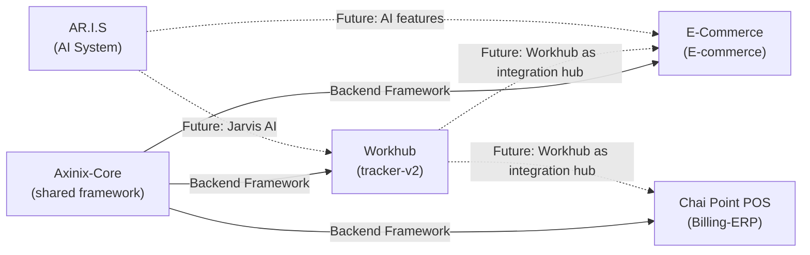

# Dependency Inventory

> **Document Reference:** AXN-DOCS-00-004  
> **Last Updated:** 2026-11-11  
> **Source:** Verified against `requirements.txt`, `pyproject.toml`, `pubspec.yaml`, `package.json` and git branch history  
> **Authored By:** Axinix Technologies Documentation System

---

## Overview

This document maps every inter-repository dependency and cross-product coupling discovered in the Axinix Technologies workspace. It identifies how products depend on shared frameworks, external services, and each other.

---

## Repository-to-Repository Dependencies

| Consumer Repository | Dependency | Dependency Repository | Integration Method | Status |
|---|---|---|---|---|
| `tracker-v2` | `django-populate-core` | `Axinix-Core` | `git+ssh://git@github.com/Axinix-Technology/Axinix-Core.git#egg=django-populate-core` | ✅ ACTIVE |
| `E-commerce` | `django-populate-core` | `Axinix-Core` | `git+ssh://git@github.com/Axinix-Technology/Axinix-Core.git` (inferred — matches pattern) | ✅ ACTIVE |
| `Billing-ERP` | `django-populate-core` | `Axinix-Core` | `git+` pip install (confirmed by recent git commit: "migrate backend to Django with axinix-django-core") | ✅ RECENTLY ADDED |

---

## Axinix-Core Dependency Details

Axinix-Core is the **single most critical shared dependency** in the ecosystem. All Django backends depend on it.

### What Axinix-Core Provides to Consumers

| Feature | Provided By | Consumer Receives |
|---|---|---|
| `/api/populate/` endpoint | `populate_core/urls.py` | Full CRUD API for all registered models |
| RBAC/ABAC enforcement | `populate_core/policy/` | Automatic per-request policy verification |
| Multi-tenant DB routing | `populate_core/` `TenantDatabaseRouter` | Physical database isolation per tenant |
| Audit logging | `populate_core/audit/` | Automatic, non-blocking request auditing |
| Rate limiting | `populate_core/security/` | Redis sliding-window rate protection |
| AST query compiler | `populate_core/query/` | Advanced filtering, sorting, pagination |
| Domain service hooks | `populate_core/registry/` | `before_create`, `after_create`, etc. lifecycle hooks |
| Response standardization | `populate_core/response/` | Consistent `{success, data, count}` envelope |
| Workflow engine | `populate_core/modules/` | Tenant-configurable multi-stage approvals |
| Background queue | `populate_core/modules/` | Async task processing with retry |

### Configuration Required in Consumer

```python
# settings.py
INSTALLED_APPS = [
    'populate_core',
    # ... business apps
]

POPULATE_CONFIG = {
    'ROLE_MODEL': 'users.Role',
    'SUPERADMIN_ROLE_FLAG': 'is_superadmin',
    'MAX_PREFETCH_DEPTH': 3,
    'CHILD_PAGINATION_CEILING': 50,
    'ENABLE_WORKFLOWS': True,
    'ENABLE_NOTIFICATIONS': True,
    'ENABLE_QUEUE': True,
}

# urls.py
urlpatterns = [
    path('api/populate/', include('populate_core.urls')),
]
```

---

## External Service Dependencies

| Service | Used By | Purpose | Integration |
|---|---|---|---|
| **MySQL 8.0+** (Aiven cloud) | `E-commerce` (production) | Primary database with SSL | `MYSQL_DATABASE_LIVE` env var |
| **MySQL 8.0+** (local) | `tracker-v2`, `E-commerce` (dev), `Billing-ERP` | Development database | `MYSQL_HOST/PORT/USER/PASS` env vars |
| **Redis** | `tracker-v2`, `Axinix-Core` | Rate limiting, caching, session | `django-redis` + Redis server |
| **AWS S3** | `E-commerce` | Media/image storage | Boto3/django-storages (inferred) |
| **GitHub** | All repos | Source code hosting | git remote |
| **HuggingFace Hub** | `AR.I.S` | Model and dataset downloads | `huggingface_hub` Python library |

---

## Dependency Risk Assessment

| Risk | Affected Repositories | Severity | Notes |
|---|---|---|---|
| **Axinix-Core breakage** | `tracker-v2`, `E-commerce`, `Billing-ERP` | 🔴 CRITICAL | All Django backends depend on it. A breaking change in Core cascades to all products. |
| **Axinix-Core git pip install** | All consumers | 🟡 MEDIUM | Installed via `git+ssh://` — requires SSH key access to private repo at build time. No PyPI publishing. |
| **MySQL version compatibility** | All backends | 🟡 MEDIUM | Django 5+/6.1 uses MySQL 8.0+. Older MySQL versions will break. |
| **Redis unavailability** | `tracker-v2`, Core rate limiter | 🟡 MEDIUM | Rate limiting and queue features fail if Redis is down. Need graceful degradation check. |
| **AWS S3 credentials** | `E-commerce` | 🟡 MEDIUM | Media storage unavailable without valid S3 credentials in environment. |
| **Flutter SDK version** | `tracker-v2` (mobile) | 🟢 LOW | Pinned to `^3.10.4`, actively maintained. |
| **React 19** | `tracker-v2`, `E-commerce` | 🟢 LOW | Cutting-edge version (React 19) — may have ecosystem compatibility issues with older packages. |

---

## Version Synchronization

Workhub's version (`4.1.1`) is synchronized across:

| Component | Version Source | Current Version |
|---|---|---|
| Backend (Django) | `version.json` | `4.1.1` |
| Frontend (React) | `version.json` (synced via npm scripts) | `4.1.1` |
| Mobile (Flutter) | `pubspec.yaml` | `4.1.1+1` |

Version management scripts in `tracker-v2`:
- `npm run version:get` — Display current version
- `npm run version:sync` — Propagate version across targets
- `npm run version:bump:patch/minor/major` — Increment and sync

---

## Cross-Platform Data Flows

Currently all Axinix products operate as independent systems. No verified real-time data sharing between products exists as of this inspection.



> [!IMPORTANT]
> Dashed lines represent planned/future integrations per the corporate portfolio vision. Solid lines represent verified, currently implemented dependencies.

---

## Related Documents

- [REPOSITORY-INVENTORY.md](./REPOSITORY-INVENTORY.md)
- [PRODUCT-INVENTORY.md](./PRODUCT-INVENTORY.md)
- [TECHNOLOGY-INVENTORY.md](./TECHNOLOGY-INVENTORY.md)
