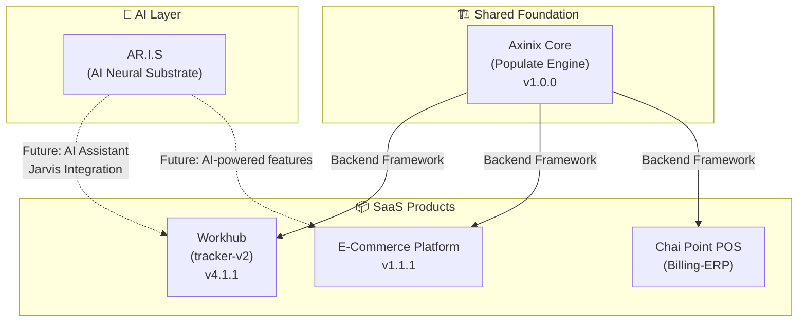

# Product Inventory

> **Document Reference:** AXN-DOCS-00-002  
> **Last Updated:** 2026-11-11  
> **Source:** Verified against `d:\Axinix Projects` repositories and corporate portfolio document  
> **Authored By:** Axinix Technologies Documentation System

---

## Overview

This document identifies every product, platform, and application discovered in the Axinix Technologies workspace. Each entry is verified against actual source code and repository inspection — not solely from README or marketing documentation.

---

## Product Registry

| # | Product Name | Repository | Category | Version | Development Status | Commercial Status |
|---|---|---|---|---|---|---|
| 1 | **Axinix Core (Populate Engine)** | `Axinix-Core` | Shared Core Framework | v1.0.0 | Production Stable | Internal framework — not sold standalone |
| 2 | **Workhub** | `tracker-v2` | Business SaaS Platform | v4.1.1 | Actively Developed | B2B SaaS — multi-tenant |
| 3 | **Axinix E-Commerce Platform** | `E-commerce` | Vertical SaaS — Retail/Manufacturing | v1.1.1 | Actively Developed | Custom vertical → SaaS |
| 4 | **Chai Point POS (Tea Shop Billing)** | `Billing-ERP` | Industry Application — Hospitality POS | No version | Active (backend migration) | Low-friction subscription SaaS |
| 5 | **AR.I.S** | `AR.I.S` | AI/ML Research — Neural Substrate | No version | Early Development | Proprietary internal (powers Axinix products) |

---

## Detailed Product Profiles

---

### Product 1: Axinix Core (Populate Engine)

**Repository:** `d:\Axinix Projects\Axinix-Core`  
**Published As:** `django-populate-core` (Python package)  
**Version:** `1.0.0`  
**Category:** Shared Core Engineering Framework  
**Development Status:** PRODUCTION STABLE  
**Commercial Deployment:** Internal framework — powers all Axinix Django backends

#### Purpose

Axinix Core is a reusable Django application providing a universal 10-stage API processing kernel for all Axinix backend platforms. It eliminates the need for per-entity URL routers, controllers, and serializers by providing a single canonical endpoint (`/api/populate/`) that handles all CRUD operations declaratively.

#### Verified Capabilities (from source structure)

| Capability | Verified | Notes |
|---|---|---|
| 10-stage request pipeline | ✅ IMPLEMENTED | `populate_core/pipeline/stages.py` |
| RBAC/ABAC policy engine | ✅ IMPLEMENTED | `populate_core/policy/` |
| Redis rate limiting (sliding window) | ✅ IMPLEMENTED | `populate_core/security/` |
| AST query compiler | ✅ IMPLEMENTED | `populate_core/query/` |
| CRUD execution engine | ✅ IMPLEMENTED | `populate_core/crud/` |
| Domain service hooks | ✅ IMPLEMENTED | `populate_core/registry/` |
| Audit logging (non-blocking) | ✅ IMPLEMENTED | `populate_core/audit/` |
| Multi-tenant database routing | ✅ IMPLEMENTED | `TenantDatabaseRouter` |
| Response standardization | ✅ IMPLEMENTED | `populate_core/response/` |
| Workflow engine | ✅ IMPLEMENTED | `populate_core/modules/` (ENABLE_WORKFLOWS config) |
| Notification module | ✅ IMPLEMENTED | `populate_core/modules/` (ENABLE_NOTIFICATIONS config) |
| Queue module | ✅ IMPLEMENTED | `populate_core/modules/` (ENABLE_QUEUE config) |
| Test suite (15 tests) | ✅ IMPLEMENTED | `tests/runtests.py` |
| Export/bulk operations | ✅ IMPLEMENTED | `populate_core/views_export.py` |
| Django admin integration | ✅ IMPLEMENTED | `populate_core/admin.py` |

#### Key Design Characteristics

- **Zero role-name string checks** — access is enforced via database-backed `AccessPolicy` capabilities
- **Physical per-tenant database isolation** — `TenantDatabaseRouter` with cryptographic token-to-tenant resolution
- **7-Layer Anti-Crash Shield** — 128-char password caps, 25MP image limits, 5s MySQL timeout, 3-tier exception absorbers
- **Automated N+1 prevention** — analyzes AST fields and auto-injects `select_related`/`prefetch_related` (max depth 3, max child pagination 50)

#### Consumers

| Consumer | Integration Method |
|---|---|
| `tracker-v2` (Workhub) | `git+ssh://git@github.com/Axinix-Technology/Axinix-Core.git` |
| `E-commerce` | `git+ssh://git@github.com/Axinix-Technology/Axinix-Core.git` |
| `Billing-ERP` | Recently integrated (git pip) |

---

### Product 2: Workhub

**Repository:** `d:\Axinix Projects\tracker-v2`  
**Version:** `4.1.1`  
**Category:** Modular Business SaaS Platform  
**Development Status:** ACTIVELY DEVELOPED  
**Commercial Status:** B2B SaaS — multi-tenant deployment

#### Purpose

Workhub is a standalone, modular business operating platform. Its purpose is to provide organizations with a unified operational environment. It supports individual module deployments, multi-module integrations, and a fully unified organizational management system.

#### Verified Modules (from backend directory structure)

| Module | Directory | Status |
|---|---|---|
| HRMS | `backend/hr/` | ✅ IMPLEMENTED |
| Attendance | `backend/attendance/` | ✅ IMPLEMENTED |
| Payroll | `backend/payroll/` | ✅ IMPLEMENTED |
| CRM | `backend/crm/` | ✅ IMPLEMENTED |
| Task Management | `backend/tasks/` | ✅ IMPLEMENTED |
| Help Desk (Tickets) | `backend/tickets/` | ✅ IMPLEMENTED |
| Billing | `backend/billing/` | ✅ IMPLEMENTED |
| Recruitment | `backend/recruitment/` | ✅ IMPLEMENTED |
| Dashboard & Analytics | `backend/dashboard/` | ✅ IMPLEMENTED |
| Notifications | `backend/notifications/` | ✅ IMPLEMENTED |
| Activity Feed | `backend/feed/` | ✅ IMPLEMENTED |
| Asset Management | `backend/assets/` | ✅ IMPLEMENTED |
| Control Plane | `backend/control_plane/` | ✅ IMPLEMENTED |
| System Config | `backend/system/` | ✅ IMPLEMENTED |
| User Management | `backend/users/` | ✅ IMPLEMENTED |

#### Verified Frontend Pages/Areas (from `Frontend/src/pages/` — requires deeper scan)

The frontend is a React 19 + Vite application with pages corresponding to backend modules.

#### Mobile Application

A Flutter mobile application (`tracker_mobile/`) exists:
- Flutter SDK `^3.10.4` / Dart
- Version: `4.1.1+1` (synchronized with platform version)
- Description: `"An unified platform to manage, HR activities, Internal Tasks and Client Queries"`
- Cross-platform: Android, iOS, Web, Linux, macOS, Windows targets
- Key dependencies: `dio` (HTTP), `provider` (state), `camera`, `image_picker`, `jwt_decoder`, `cached_network_image`, `shimmer`

#### Key Technical Characteristics

- Multi-tenant (physical database per tenant via `TenantDatabaseRouter`)
- HRMS-first architecture with integrated payroll, attendance, and statutory compliance
- Active development: 30+ remote branches including feature, bugfix, and core branches
- Recently promoted Django backend as canonical (v4.0+), retiring legacy Node.js backend
- Jarvis AI assistant feature branch (`feat/jarvis-ai-assistant`) — in development

---

### Product 3: Axinix E-Commerce Platform

**Repository:** `d:\Axinix Projects\E-commerce`  
**Version:** `1.1.1`  
**Category:** Vertical SaaS — Retail and Manufacturing  
**Development Status:** ACTIVELY DEVELOPED  
**Commercial Status:** Custom vertical deployment transitioning to industry SaaS

#### Purpose

An enterprise omnichannel inventory and billing platform for manufacturers, brands, and multi-channel retailers. Provides centralized catalog management, inventory tracking, POS billing, order fulfillment, channel synchronization, and storefront services.

#### Verified Domain Modules (from backend directory)

| Domain | Directory | Status |
|---|---|---|
| Product Catalog | `backend/catalogue/` | ✅ IMPLEMENTED |
| Inventory Management | `backend/inventory/` | ✅ IMPLEMENTED |
| Inward Processing (Stock Receiving) | `backend/inward/` | ✅ IMPLEMENTED |
| Order Management | `backend/orders/` | ✅ IMPLEMENTED |
| Channel Management (Omnichannel) | `backend/channels/` | ✅ IMPLEMENTED |
| Storefront | `backend/storefront/` | ✅ IMPLEMENTED |
| Company Master | `backend/company/` | ✅ IMPLEMENTED |
| Media/Image Management | `backend/media/` | ✅ IMPLEMENTED |
| External Integrations | `backend/integrations/` | ✅ IMPLEMENTED |
| User Management | `backend/users/` | ✅ IMPLEMENTED |
| Print Spooler (Barcode/Labels) | `spooler/` | ✅ IMPLEMENTED |

#### Key Technical Characteristics

- Dual-mode database: local MySQL (DEBUG=True) / Aiven cloud MySQL SSL (DEBUG=False)
- AWS S3 for media/image storage
- DualPasswordBackend (SHA-256 pre-hash from client)
- DRF Token authentication
- COD (Cash on Delivery) delivery agent workflow
- Barcode tag generation with auto-print-download
- Order cancellation workflow with approval states

---

### Product 4: Chai Point POS (Tea Shop Billing)

**Repository:** `d:\Axinix Projects\Billing-ERP`  
**Version:** No formal version  
**Category:** Industry Application — Hospitality/Retail POS  
**Development Status:** ACTIVE — Backend migration in progress  
**Commercial Status:** Subscription SaaS (planned)

#### Purpose

A point-of-sale billing and store management application originally built for tea shops and cafes. Provides fast counter billing, automatic tax computation (GST), PDF receipt generation, analytics dashboard, and role-based access control.

#### Verified Domain Modules (from backend directory)

| Domain | Directory | Status |
|---|---|---|
| POS Billing | `backend/billing/` | ✅ IMPLEMENTED |
| Product/Menu Management | `backend/products/` | ✅ IMPLEMENTED |
| Reports & Analytics | `backend/reports/` | ✅ IMPLEMENTED |
| User Management & RBAC | `backend/users/` | ✅ IMPLEMENTED |

#### Migration Status

| Component | Previous Stack | Current Stack | Status |
|---|---|---|---|
| Backend | Node.js + Express + MySQL | Django + Axinix-Core + SQLite/MySQL | ✅ MIGRATED |
| Frontend | React + Vite | React + Vite (retained) | ✅ RETAINED |
| Auth | JWT + Bcryptjs | Axinix-Core ABAC + DB-backed policies | ✅ MIGRATED |
| PDF Generation | PDFKit (Node) | Django (implementation requires inspection) | ⚠️ REQUIRES INSPECTION |

---

### Product 5: AR.I.S (Artificial Intelligent System)

**Repository:** `d:\Axinix Projects\AR.I.S`  
**Version:** No formal version  
**Category:** AI/ML Research — Proprietary Neural Substrate  
**Development Status:** EARLY DEVELOPMENT  
**Commercial Status:** Internal intelligence layer

#### Purpose

AR.I.S is Axinix's proprietary neural AI system. It is a cognitive AI substrate supporting autonomous task reasoning, AST codebase inspections, and intelligent decision engines intended to eventually power all Axinix products. The system includes custom tokenizer development, multi-corpus training, cognitive linguistic processing, and an inference engine.

#### Verified Components (from `aris/` directory)

| Component | Directory | Status |
|---|---|---|
| Core Cognitive Engine | `aris/core/` | ✅ IMPLEMENTED (early) |
| Configuration Management | `aris/configs/` | ✅ IMPLEMENTED |
| Data Ingestion & Preprocessing | `aris/data/` | ✅ IMPLEMENTED |
| Evaluation Suite | `aris/evaluation/` | ✅ IMPLEMENTED |
| Inference Engine | `aris/inference/` | ✅ IMPLEMENTED |
| Cognitive Linguistic Processing | `aris/linguistic/` | ✅ IMPLEMENTED |
| Memory System | `aris/memory/` | ✅ IMPLEMENTED |
| Neural Model Definitions | `aris/models/` | ✅ IMPLEMENTED |
| Custom Tokenizer | `aris/tokenizer/` | ✅ IMPLEMENTED |
| Training Pipeline | `aris/training/` | ✅ IMPLEMENTED |

#### Training Datasets Verified

| Dataset | Category | Directory |
|---|---|---|
| GSM8K | Mathematical reasoning | `data/gsm8k/` |
| MBPP | Code generation | `data/mbpp/` |
| HotpotQA | Multi-hop question answering | `data/hotpotqa/` |
| qasrl_gs | Semantic role labeling / Linguistic | `data/qasrl_gs/` |
| UltraChat 200k | Conversational AI | `data/ultrachat_200k/` |
| Vision | Computer vision | `data/vision/` |

---

## Product Relationship Map

---

## Corporate Portfolio Alignment

Based on the corporate portfolio document (`Axinix Technologies Portfolio.md`), the product strategy aligns as follows:

| Corporate Portfolio Listing | Actual Repository | Verification |
|---|---|---|
| AR.I.S (Artificial Intelligent System) | `AR.I.S` | ✅ VERIFIED |
| Workhub (Modular Enterprise Suite) | `tracker-v2` | ✅ VERIFIED |
| Textile Industrial ERP & E-Commerce | `E-commerce` | ⚠️ PARTIAL — E-commerce verified; Textile ERP component requires deeper inspection |
| Café & Retail Billing POS | `Billing-ERP` | ✅ VERIFIED |
| Populate Engine | `Axinix-Core` | ✅ VERIFIED |

> [!NOTE]
> The corporate portfolio describes a **Textile Industrial ERP** as a distinct product. The `E-commerce` repository appears to serve the retail/e-commerce use case. A dedicated Textile ERP may exist as a separate deployment configuration of the E-commerce platform, or may be a separate product not yet present in this workspace.

---

## Related Documents

- [REPOSITORY-INVENTORY.md](./REPOSITORY-INVENTORY.md)
- [TECHNOLOGY-INVENTORY.md](./TECHNOLOGY-INVENTORY.md)
- [DEPENDENCY-INVENTORY.md](./DEPENDENCY-INVENTORY.md)

