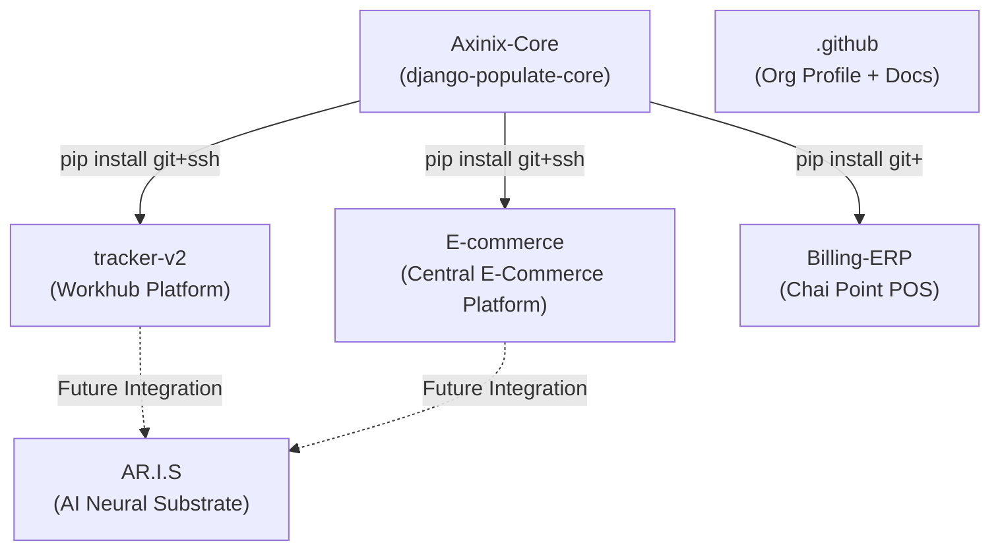

# Repository Inventory

> **Document Reference:** AXN-DOCS-00-001  
> **Last Updated:** 2026-11-11  
> **Inspection Status:** Phase 1 Complete — All repositories inventoried via source inspection  
> **Authored By:** Axinix Technologies Documentation System

---

## Overview

This document records every repository discovered in the Axinix Technologies workspace (`d:\Axinix Projects`). Each repository has been inspected by examining its root structure, README files, source code directories, dependency files, git history, and branch activity.

---

## Repository Map

| # | Repository | Product | Purpose | Category | Technologies | Database | Dependencies | Status | Documentation | Inspection Status |
|---|---|---|---|---|---|---|---|---|---|---|
| 1 | `Axinix-Core` | Axinix Core (Populate Engine) | Universal 10-stage API processing kernel for all Axinix Django platforms. Provides RBAC/ABAC, rate limiting, AST query compiler, audit logging, multi-tenant database routing, and declarative model registration. Published as `django-populate-core` package. | Shared Core Library | Python 3.11+, Django 5.0+, DRF 3.14+, Redis, MySQL, Pillow, openpyxl | None (framework library) | None (self-contained) | ACTIVE — Production Stable v1.0.0 | Good README + source inline docs | ✅ Fully Inspected |
| 2 | `tracker-v2` | Workhub | Full-stack multi-tenant SaaS business operating platform. Includes HRMS, Attendance, Payroll, CRM, Tasks, Tickets, Billing, Recruitment, Notifications, Dashboard, Feed, and mobile app. | Product — SaaS Platform | Python/Django (backend), React 19 + Vite (frontend), Flutter/Dart (mobile), MySQL, Redis | MySQL (multi-tenant per-database isolation) | `Axinix-Core` (via git pip) | ACTIVE — v4.1.1 (main branch) | Minimal README, extensive `knowledge_brain/` | ✅ Fully Inspected |
| 3 | `E-commerce` | Axinix E-Commerce Platform | Omnichannel inventory and billing platform for manufacturers, brands and multi-channel retailers. Includes POS billing, catalog management, inventory tracking, order management, channel management, and storefront. | Product — Vertical SaaS | Python/Django 6.1 (backend), React 19 + Vite 6 (frontend), MySQL, AWS S3 | MySQL (Aiven cloud in production, local in dev) | `Axinix-Core` (via git pip) | ACTIVE — v1.1.1 (staging branch active) | Good README with setup instructions | ✅ Fully Inspected |
| 4 | `Billing-ERP` | Tea Shop Billing (Chai Point POS) | Point-of-sale billing and store management application for tea shops and retail. Includes POS billing, PDF invoices, admin dashboard, menu management, and RBAC. Recently migrated from Node.js to Django backend. | Product — Industry Application (Hospitality) | Python/Django (backend, migrated from Node.js/Express), React (frontend), SQLite (dev)/MySQL | SQLite (dev), MySQL planned | `Axinix-Core` (recently integrated) | ACTIVE — Early Django migration phase | Minimal README (Node era docs) | ✅ Fully Inspected |
| 5 | `AR.I.S` | AR.I.S (Artificial Intelligent System) | Proprietary neural AI substrate. Multi-corpus language model training system with cognitive linguistic processing, custom tokenizer, inference engine, memory system, and evaluation suite. | Research & Development — AI System | Python 3.x, PyTorch 2.0+, HuggingFace Datasets/Tokenizers, NumPy, PyArrow, MySQL | MySQL (via PyMySQL, for training metadata) | None (self-contained AI project) | ACTIVE — Early Development (5 commits) | Minimal README | ✅ Fully Inspected |
| 6 | `.github` | Axinix Technologies (Organization) | Organization-level GitHub profile repository containing corporate portfolio, foundational strategy blueprint, founder agreement documentation, and organization assets. Also designated as the central documentation repository for this documentation initiative. | Organization — Corporate Documentation | Markdown | None | None | ACTIVE — Corporate documents | Corporate Portfolio, Founders Packet, Charter | ✅ Fully Inspected |
| 7 | `.agents` | (Shared Workspace Config) | Workspace-level agent configuration directory containing shared skills for backend Python environment. Not an independent repository. | Configuration | SKILL.md agent skill | None | None | ACTIVE | Skill instructions | ✅ Fully Inspected |
| 8 | `Arun` | (Personal/Internal Notes) | Personal working notes directory with text files about Amazon Cloud infrastructure, work status, and Workhub contribution notes. Not a git repository. | Internal Notes — Personal | Plain text | None | None | PERSONAL NOTES — Not a git repo | No documentation | ✅ Fully Inspected |
| 9 | `media` | (Shared Media) | Shared media directory. Appears empty based on directory scan. Contains no visible content files. | Shared Asset Store | N/A | None | None | EMPTY | None | ✅ Fully Inspected |

---

## Detailed Repository Profiles

### 1. Axinix-Core (`d:\Axinix Projects\Axinix-Core`)

**Git Remote:** `github.com/Axinix-Technology/Axinix-Core`  
**Published Package Name:** `django-populate-core`  
**Version:** `1.0.0` (pyproject.toml)  
**Git History:** 2 commits (`f2e6a7a Initial commit`, `aed9934 Initialize Core of axinix`)

**Root Structure:**
```
Axinix-Core/
├── populate_core/          # Main Django app package
│   ├── audit/              # Audit logging subsystem
│   ├── crud/               # CRUD execution engine
│   ├── management/         # Django management commands
│   ├── modules/            # Pluggable modules (workflows, notifications, queue)
│   ├── pipeline/           # 10-stage pipeline (stages.py, executor.py, context.py)
│   ├── policy/             # RBAC/ABAC policy engine
│   ├── query/              # AST query compiler
│   ├── registry/           # Model and service registration
│   ├── response/           # Standardized response formatting
│   ├── security/           # Security layer (rate limiting, etc.)
│   ├── serialization/      # Output serializers
│   ├── utils/              # Utility functions
│   ├── validation/         # Input validation
│   ├── middleware.py        # Django middleware
│   ├── models.py           # Core database models (AccessPolicy, AuditLog, etc.)
│   ├── views.py            # PopulateView entry point
│   ├── urls.py             # URL routing (single /api/populate/ endpoint)
│   └── conf.py             # Configuration via POPULATE_CONFIG
├── tests/                  # Test suite (15 tests, all passing)
├── Docs/                   # Additional documentation
├── pyproject.toml          # Package metadata
├── setup.cfg               # Build configuration
└── README.md               # Comprehensive architectural documentation
```

**Key Technology Facts:**
- Python `>=3.11`, Django `>=5.0`, DRF `>=3.14`
- Optional dependencies: `mysqlclient`, `redis`/`django-redis`, `pillow`, `openpyxl`
- MIT License
- Single canonical endpoint: `POST /api/populate/<action>/<model>/`
- 10-stage processing pipeline (see detailed docs)
- Authors: `engineering@axinix.com`

---

### 2. tracker-v2 (`d:\Axinix Projects\tracker-v2`)

**Git Remote:** `github.com/nexonic-technologies/...` (remote origin observed in branch names)  
**Version:** `4.1.1` (version.json)  
**Product Name:** `workhub-tracker-v2`  
**Min Supported Client Version:** `3.0.0`  
**Active Branches:** `main`, `staging`, `feat-django-backend-promotion`, plus 30+ remote feature/bugfix branches

**Root Structure:**
```
tracker-v2/
├── backend/                # Django REST API Backend
│   ├── assets/             # Asset management module
│   ├── attendance/         # Attendance tracking module
│   ├── billing/            # Billing module
│   ├── config/             # Django project config
│   ├── constants/          # Shared constants
│   ├── control_plane/      # Platform control plane
│   ├── crm/                # CRM module
│   ├── dashboard/          # Dashboard and analytics
│   ├── feed/               # Activity feed
│   ├── hr/                 # HRMS module
│   ├── notifications/      # Notification system
│   ├── payroll/            # Payroll module
│   ├── recruitment/        # Recruitment module
│   ├── system/             # System configuration
│   ├── tasks/              # Task management
│   ├── tests_api/          # API test suite
│   ├── tickets/            # Help desk tickets
│   └── users/              # User management and auth
├── Frontend/               # React 19 + Vite web application
│   └── src/
│       ├── api/            # API client layer
│       ├── components/     # Reusable UI components
│       ├── constants/      # Frontend constants
│       ├── context/        # React context providers
│       ├── design/         # Design system
│       ├── engine/         # Frontend processing engine
│       ├── hooks/          # Custom React hooks
│       ├── layouts/        # Page layouts
│       ├── pages/          # Feature pages
│       ├── platformAdmin/  # Platform admin panel
│       ├── providers/      # Data providers
│       ├── services/       # Service layer
│       ├── store/          # State management
│       └── utilities/      # Utility functions
├── tracker_mobile/         # Flutter mobile application (Android + iOS)
│   └── lib/                # Dart source code
├── External/               # External integration components
├── docs/                   # Existing documentation
├── knowledge_brain/        # Extensive module-level knowledge base
├── scripts/                # Utility scripts
├── deploy.ps1              # PowerShell deployment script
└── version.json            # Version metadata
```

**Backend Tech:** Python/Django (Axinix-Core via `git+ssh://...Axinix-Core.git`), `pymysql`, `pyjwt`, `python-dotenv`, `django-cors-headers`, `cryptography`  
**Frontend Tech:** React 19, Vite, (framework details require deeper scan)  
**Mobile Tech:** Flutter/Dart 3.10+, `dio`, `provider`, `camera`, `image_picker`, `jwt_decoder`  
**Database:** MySQL (multi-tenant, per-tenant database isolation via Axinix-Core's `TenantDatabaseRouter`)

---

### 3. E-commerce (`d:\Axinix Projects\E-commerce`)

**Git Remote:** Has `.git` directory (remote details require deeper scan)  
**Version:** `1.1.1` (version.json)  
**Product Name:** `central-ecommerce-platform`  
**Active Branches:** `staging` branch active (most recent commits)

**Root Structure:**
```
E-commerce/
├── backend/                # Django 6.1 REST API Backend
│   ├── catalogue/          # Product catalog and variants
│   ├── channels/           # Omnichannel marketplace management
│   ├── company/            # Company master and branding
│   ├── config/             # Django project configuration
│   ├── core/               # Core shared utilities
│   ├── integrations/       # External integrations
│   ├── inventory/          # Stock tracking
│   ├── inward/             # Inward batch processing
│   ├── media/              # Media handling
│   ├── orders/             # Order management and fulfillment
│   ├── services/           # Domain service layer
│   ├── src/                # Additional source
│   ├── storefront/         # Storefront services
│   └── users/              # User management and RBAC
├── frontend/               # React 19 + Vite 6 Admin Console
├── ecommerce/              # Additional ecommerce app
├── database/               # Database references/schemas
├── Docs/                   # Documentation
├── knowledge_brain/        # Module knowledge base
├── scripts/                # Utility scripts
├── spooler/                # Print spooler / barcode
└── version.json            # Version metadata
```

**Key Recent Features (from git log):**
- S3 direct access for media storage
- Order cancellation workflow
- COD delivery agent hub
- Barcode tag generation with auto-download
- Path-based staging deployment architecture

**Backend Tech:** Python/Django 6.1, DRF, Axinix-Core (git pip), MySQL (Aiven cloud SSL + local MySQL), AWS S3  
**Frontend Tech:** React 19, Vite 6, Tailwind CSS v4, Axios  
**Auth:** DualPasswordBackend (SHA-256 pre-hashing + raw password), DRF Token auth

---

### 4. Billing-ERP (`d:\Axinix Projects\Billing-ERP`)

**Version:** Not versioned (early stage)  
**Git History:** 6 commits (most recent: Django migration with Axinix-Core)

**Root Structure:**
```
Billing-ERP/
├── backend/                # Django REST API (recently migrated from Node.js)
│   ├── billing/            # Billing domain module
│   ├── config/             # Django project config
│   ├── products/           # Product/menu management
│   ├── reports/            # Reports module
│   └── users/              # User management
├── frontend/               # React frontend (retained from Node era)
├── knowledge_brain/        # Module knowledge base
└── README.md               # Node.js era documentation (outdated)
```

**Key Facts:**
- Originally a Node.js/Express + MySQL application ("Tea Shop Billing — Chai Point POS")
- Recently migrated backend to Django with Axinix-Core integration and DB-backed ABAC
- Frontend (React) appears retained from original Node.js era
- Uses SQLite for development (`billing_erp_dev.sqlite3` exists)
- Primary domain: tea shop/cafe POS billing, PDF invoices, dashboard analytics

**Backend Tech:** Python/Django (new), Axinix-Core, SQLite (dev), MySQL planned  
**Frontend Tech:** React (from original Node.js era)  
**Previous Stack:** Node.js, Express.js, MySQL, JWT, Bcryptjs, PDFKit

---

### 5. AR.I.S (`d:\Axinix Projects\AR.I.S`)

**Version:** Not versioned  
**Git History:** 5 commits  

**Root Structure:**
```
AR.I.S/
├── aris/                   # Main Python package
│   ├── configs/            # Configuration management
│   ├── core/               # Core cognitive engine
│   ├── data/               # Data ingestion and preprocessing
│   ├── evaluation/         # Model evaluation suite
│   ├── inference/          # Inference engine
│   ├── linguistic/         # Cognitive linguistic processing (CognitiveLinguisticFrame)
│   ├── memory/             # Memory system
│   ├── models/             # Neural model definitions
│   ├── tokenizer/          # Custom tokenizer
│   └── training/           # Training pipeline
├── data/                   # Datasets
│   ├── gsm8k/              # Math reasoning dataset
│   ├── hotpotqa/           # Multi-hop QA dataset
│   ├── mbpp/               # Code generation dataset
│   ├── qasrl_gs/           # Question-answer semantic role labeling
│   ├── ultrachat_200k/     # Conversational AI dataset
│   └── vision/             # Vision data
├── models/                 # Trained model artifacts
│   ├── legacy_archive/     # Archived legacy models
│   └── memory/             # Memory model files
├── knowledge_brain/        # Alphabetical knowledge base (A-V categories)
├── workspace/              # Working directory
├── run.py                  # Main entry point
└── requirements.txt        # PyTorch, Tokenizers, Datasets, etc.
```

**Key Facts:**
- Proprietary neural language model development project
- Training datasets: GSM8K (math), MBPP (code), HotpotQA (multi-hop reasoning), qasrl_gs (linguistic), UltraChat 200k (conversation), vision datasets
- CognitiveLinguisticFrame: custom linguistic processing module (explicitly mentioned in rules as the neural tensor substrate for all linguistic decisions)
- Uses PyMySQL for training metadata storage
- Has `.venv` (Python virtual environment)
- Has `.env` (environment configuration)

**Tech Stack:** Python 3.x, PyTorch 2.0+, HuggingFace Tokenizers, HuggingFace Datasets/Hub, NumPy, PyArrow, PyMySQL

---

### 6. .github (`d:\Axinix Projects\.github`)

**Purpose:** GitHub organization profile repository + designated central documentation repository  
**Git History:** Active git repository with assets directory

**Contents:**
- `Axinix Technologies Portfolio.md` — Corporate portfolio and foundational strategy blueprint
- `Axinix_Corporate_Charter_and_Commercial_Playbook.md` — Corporate charter and commercial playbook
- `Axinix_Founders_Execution_and_Signing_Packet.md` — Founders agreement and signing documents
- `profile/` — GitHub organization profile assets
- `assets/` — Logo and branding assets
- `docs/` — **This documentation system (being created)**

---

## Repository Relationships



---

## Discovery Notes

1. **`media` directory** appears empty — may be a shared media volume mount point for development.
2. **`Arun` directory** is a personal notes folder (not a git repository) — contains Amazon Cloud notes, work status, and Workhub contribution records.
3. **`.agents` directory** contains shared workspace agent skills (specifically the `backend-python-env` skill defining the Python virtual environment path).
4. **tracker-v2** was originally developed under a `nexonic-technologies` GitHub organization (visible in remote branch references) before migration to Axinix Technologies.
5. **Billing-ERP** is currently in a transitional state — the README documents the Node.js era while the backend has been migrated to Django with Axinix-Core.
6. **All Workhub, E-commerce, and Billing-ERP backends depend on Axinix-Core** as a shared framework installed via git pip.

---

## Related Documents

- [PRODUCT-INVENTORY.md](./PRODUCT-INVENTORY.md)
- [TECHNOLOGY-INVENTORY.md](./TECHNOLOGY-INVENTORY.md)
- [DEPENDENCY-INVENTORY.md](./DEPENDENCY-INVENTORY.md)

