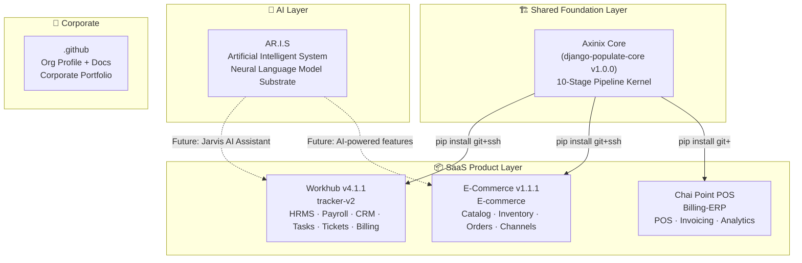
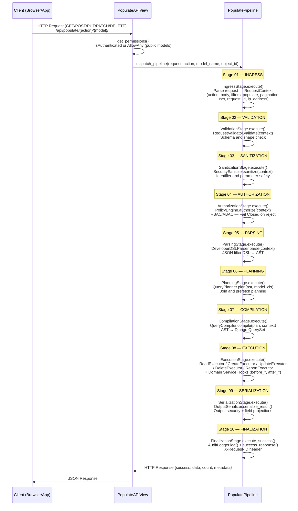
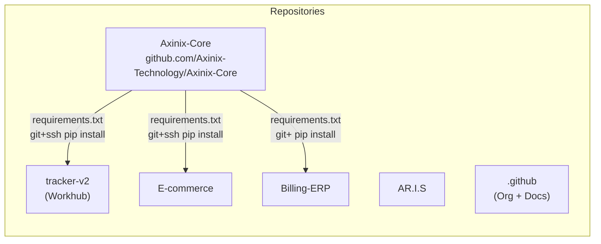
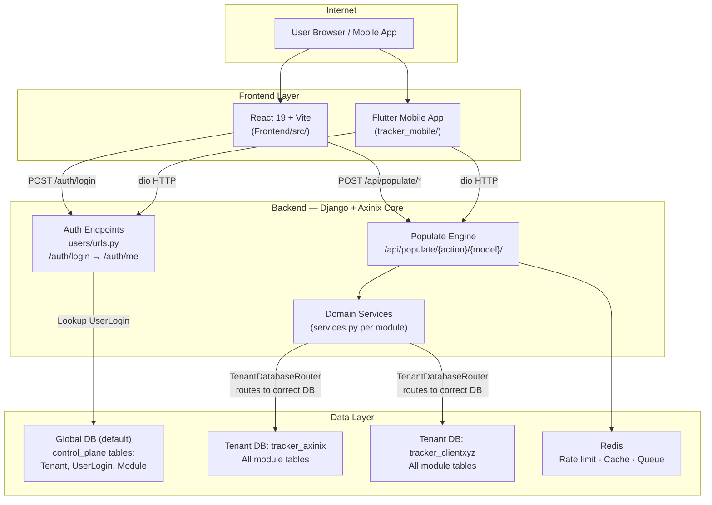
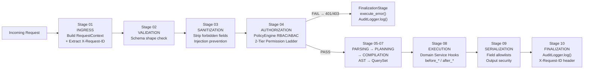
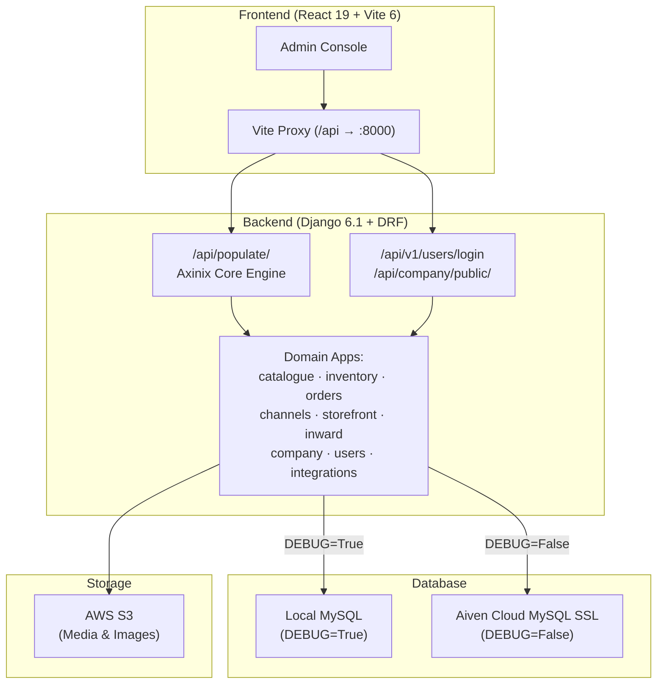
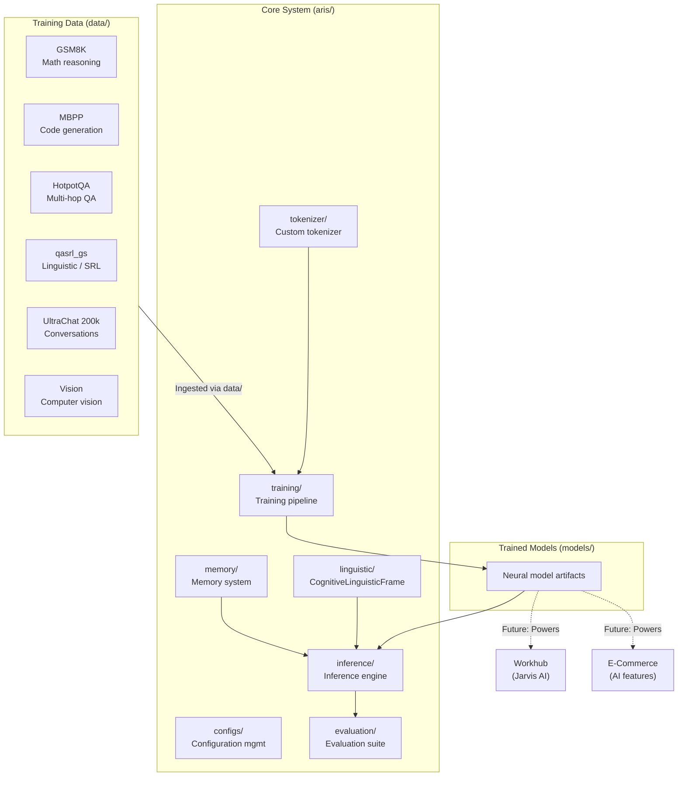
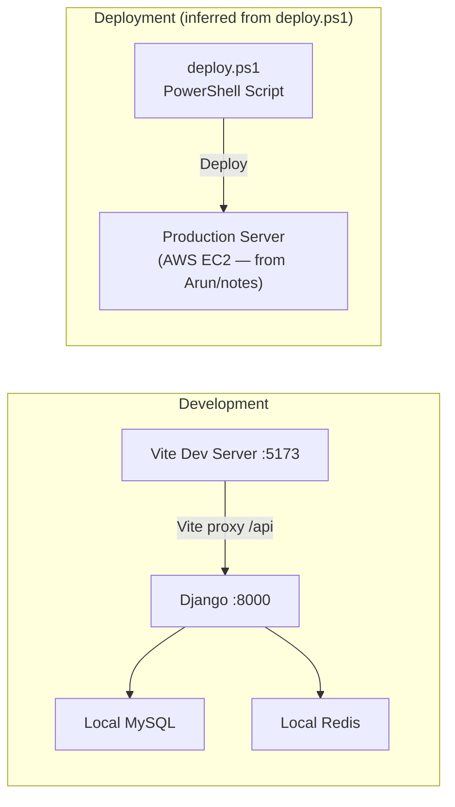

# Axinix Ecosystem — Architecture Diagrams

> **Document Reference:** AXN-DOCS-05-ARCH-001  
> **Last Updated:** 2026-11-11  
> **Authored By:** Axinix Technologies Documentation System  
> **Source:** Evidence-based from repository inspection

---

## 1. Axinix Product Ecosystem Map

---

## 2. Axinix Core — 10-Stage Request Pipeline

---

## 3. Repository Relationships

---

## 4. Workhub Multi-Tenant Architecture

---

## 5. Axinix Core Security Architecture

---

## 6. E-Commerce Platform Architecture

---

## 7. AR.I.S Neural Architecture

---

## 8. Deployment Architecture (Workhub)

> [!NOTE]
> Production deployment details (server IPs, hostnames, SSL certificates, AWS configuration) are referenced in `Arun/Amazon Cloud.txt` but are not documented here for security reasons. Contact the DevOps team (Rithika, Co-Founder DevOps Head) for production infrastructure access.

---

## Related Documents

- [../00-discovery/REPOSITORY-INVENTORY.md](../00-discovery/REPOSITORY-INVENTORY.md)
- [../02-shared-technology/axinix-core/ARCHITECTURE.md](../02-shared-technology/axinix-core/ARCHITECTURE.md)
- [../03-products/workhub/OVERVIEW.md](../03-products/workhub/OVERVIEW.md)

