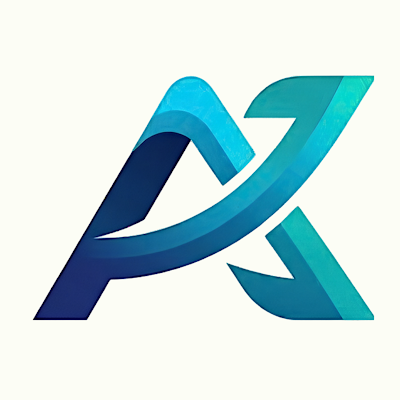
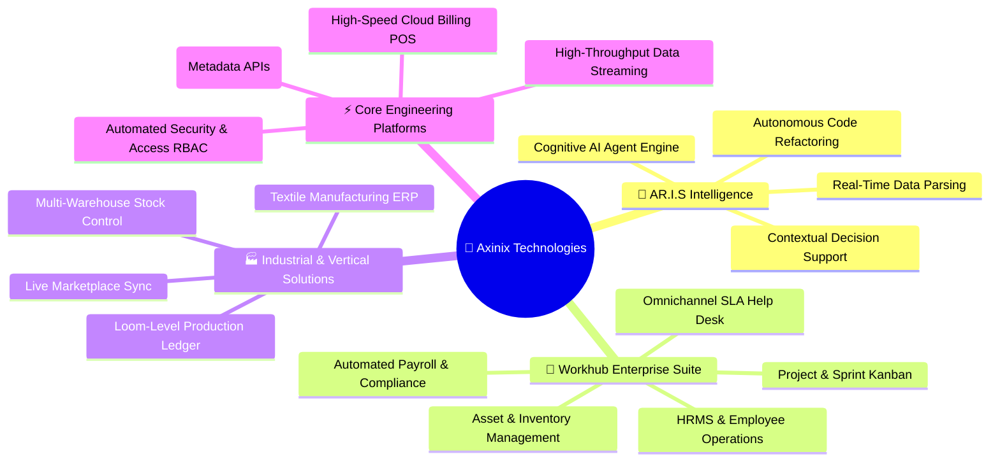

<p align="center">
  
</p>

<div align="center">

```
   █████╗ ██╗   ██╗██╗███╗   ██╗██╗██╗  ██╗
  ██╔══██╗╚██╗ ██╔╝██║████╗  ██║██║╚██╗██╔╝
  ███████║ ╚████╔╝ ██║██╔██╗ ██║██║ ╚███╔╝ 
  ██╔══██║ ██╔═██╗ ██║██║╚██╗██║██║ ██╔██╗ 
  ██║  ██║██╔╝ ██╗ ██║██║ ╚████║██║██╔╝ ██╗
  ╚═╝  ╚═╝╚═╝  ╚═╝╚═╝╚═╝  ╚═══╝╚═╝╚═╝  ╚═╝
   T   E   C   H   N   O   L   O   G   I   E   S
```

# 🌌 Axinix Technologies
### *"Innovating Future, Today"*

---

[](#)
[](#)
[](#-leadership-team)
[](#-commercial-product-portfolio)
[](../Axinix_Corporate_Charter_and_Commercial_Playbook.md)

<br />

**Axinix Technologies** is an enterprise technology innovation company building next-generation software platforms, intelligent autonomous AI agents, and modular cloud architectures. We transform real-world business complexity into dependable digital solutions designed to scale enterprises smoothly to global markets.

---

### 🏛️ CORPORATE GOVERNANCE & CHARTER
> [!NOTE]
> The complete operating principles, commercial governance, profit-sharing model, and portfolio architecture of Axinix Technologies are detailed in our master document:  
> 📖 **[Read the Axinix Corporate Charter & Commercial Playbook](../Axinix_Corporate_Charter_and_Commercial_Playbook.md)**

---

</div>

<br />

## 🌐 Commercial Product Portfolio



---

### 1. 🤖 AR.I.S — Artificial Intelligent System
> **Enterprise AI & Autonomous Cognitive Automation**

* **Cognitive Decision Engines:** Neural tensor architectures designed for autonomous enterprise workflows, contextual recommendations, and intelligent system orchestration.
* **Autonomous Task Reasoning:** Streamlines multi-step technical pipelines, automated code reviews, AST inspections, and dynamic business logic synthesis.
* **Embedded Platform Intelligence:** Directly integrated into the Populate Engine and Workhub to provide instant operational insights and predictive analytics.

---

### 2. 🏢 Workhub — Modular Enterprise Operations Platform
> **Unified All-In-One Enterprise Management Suite**

Built on the principle that modules must be **independently deployable and exponentially more valuable when unified**:
* **HRMS & People Operations:** End-to-end employee lifecycle management, biometric attendance sync, automated leave policies, and shift planning.
* **Automated Payroll & Compliance:** Accurate salary computation, statutory deductions (PF/ESI/TDS), digital payslips, and tax filings.
* **Service Desk & SLA Management:** Multi-channel customer and internal support ticketing, SLA tracking, and automated escalation.
* **Project & Workflow Management:** Interactive sprint boards, backlog planning, and executive milestone delivery tracking.
* **Enterprise Asset Ledger:** Real-time tracking of hardware, devices, software licenses, and asset allocation across business units.

---

### 3. 🏭 Industrial & Vertical Enterprise Solutions
> **Domain-Specific ERP & Omnichannel Commerce**

* **Textile Manufacturing ERP:** Deep vertical specialization covering spinning, weaving, wet processing, yarn tracking, and loom-level metrics.
* **Live Marketplace Integration:** Real-time bidirectional stock and order synchronization with Amazon, Flipkart, and wholesale portals.
* **Unified Inventory Ledger:** Centralized multi-warehouse reservation preventing overselling across digital and physical wholesale channels.

---

### 4. ⚡ Populate Engine
> **High-Performance Metadata-Driven API Platform**

* **Elimination of Redundant Controllers:** Custom business logic executes cleanly within modular domain service hooks (`services/<model>.js`), maximizing reuse and performance.
* **Enterprise Security & Policy Controls:** Built-in field-level data sanitization (`sanitizeWrite`, `sanitizeRead`), fine-grained RBAC, and immutable audit logging.
* **Sub-Millisecond Data Latency:** Minimal database lock windows, composite soft-delete indexing, and automated query optimization.

---

## 👥 Leadership Team

Axinix is directed by an eight-member executive team combining enterprise software engineering, quality assurance, infrastructure operations, and business strategy.

<div align="center">

| Executive | Role & Title | Strategic Focus |
| :--- | :--- | :--- |
| **Arunbharathi** | **Chief Executive Officer & CTO** | Corporate Strategy, Systems Architecture & Technology Direction |
| **Ajay** | **Head of Development & Processing** | Engineering Execution & Technical Operations |
| **Boopalan** | **Core Development Lead** | Enterprise Backend Services & Database Architecture |
| **Guru Prasanth** | **Quality Assurance Lead** | Quality Strategy, Functional Verification & Release Certification |
| **Karuppasamy** | **QA & Test Automation Specialist** | Automated Test Suites & Performance Engineering |
| **Rithika** | **Head of Operations & DevOps** | Operations Management, CI/CD Cloud Infrastructure & Culture |
| **Ruthran** | **Senior Frontend Engineer** | Client Applications, Workhub UI & Responsive UX |
| **Siva** | **Head of Business Strategy & R&D** | Market Discovery, Commercial Validation & Exploratory Labs |

</div>

---

## 🛠️ Technology Radar & Core Stack

<div align="center">

| Layer | Technologies & Platforms |
| :--- | :--- |
| **AI & Intelligent Systems** | Python, PyTorch, AR.I.S, AST Transformers, Vector Embeddings |
| **Backend & APIs** | Node.js (LTS), Express.js, TypeScript, Populate Engine Pipeline, Python Django REST Api |
| **Frontend & Mobile** | React 19, Next.js, Vite, React Native, Tailwind CSS, Lucide Icons, FLutter |
| **Data & Storage** | MongoDB Atlas, Redis Caching, Cloudflare R2, Streaming Gzip Archives, MySQL |
| **DevOps & Cloud** | GitHub Actions CI/CD, Scheduled Automation, Linux |

</div>

<p align="center">


</p>

---

## 📐 Core Engineering & Quality Principles

1. **"Understand Before Engineering"** — We observe actual operational workflows before proposing any technical solution.
2. **"Our Mistakes Are Our Responsibility"** — We do not bill clients for our defects, even after warranty expiry. Engineers are fairly paid for defect remediation.
3. **The Standardization Ladder** — Level 1: Client Customization $\rightarrow$ Level 2: Generalized Configurable Capability $\rightarrow$ Level 3: Universal Industry Standard.
4. **Populate-Helper First** — All domain logic resides in decoupled domain service hooks (`services/<model>.js`), inheriting automated RBAC, data sanitization, and audit logging.

---

<div align="center">

### 🤝 Partner With Axinix Technologies

We build dependable enterprise platforms that adapt, extend, and scale with your business.  
To explore commercial engagements, partnerships, or enterprise solutions:

📧 **Executive Contact:** [`contact@axinixtechnologies.com`](mailto:contact@axinixtechnologies.com) • [`axinixtechnologies@gmail.com`](mailto:axinixtechnologies@gmail.com)  
🌐 **Website:** [https://axinixtechnologies.com](https://axinixtechnologies.com)  
📜 **Corporate Governance:** [Axinix Corporate Charter & Commercial Playbook](../Axinix_Corporate_Charter_and_Commercial_Playbook.md)

<br />

```
═════════════════════════════════════════════════════════════════════════════════════════════
                 AXINIX TECHNOLOGIES • INNOVATING FUTURE, TODAY
═════════════════════════════════════════════════════════════════════════════════════════════
```

</div>
